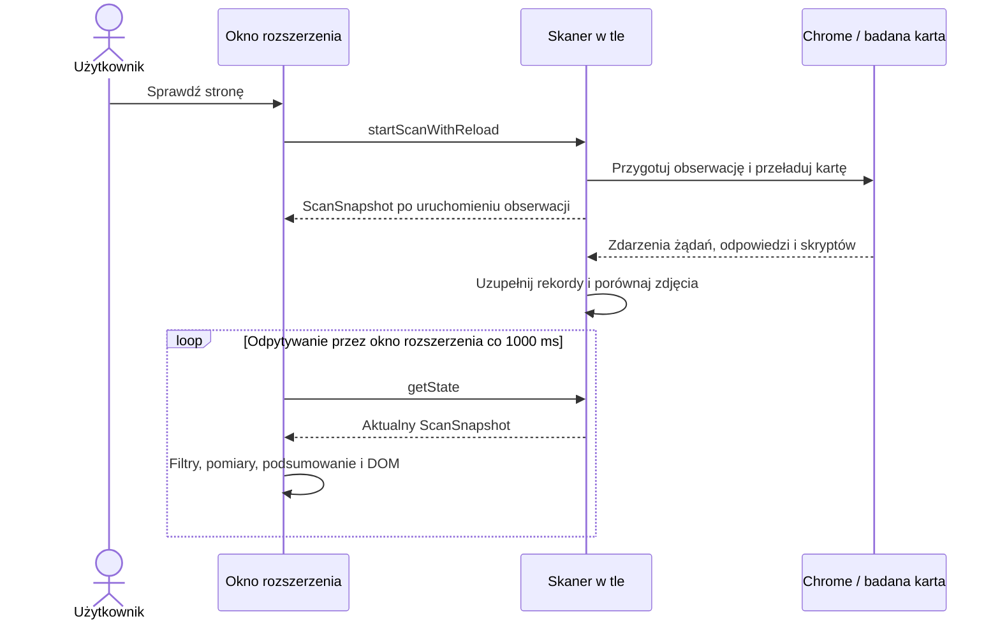

# Przepływ działania wtyczki

Ten przewodnik prowadzi od działania użytkownika do zmiany danych i widoku.
Zakłada znajomość funkcji, obiektów, zdarzeń i `async/await` w JavaScript.
Każdy etap wskazuje funkcję, którą warto otworzyć jako następną.

## Kolejność czytania

1. Przeczytaj ten plik: miejsca wykonania, komunikacja i aktualizacja okna rozszerzenia.
2. Przejdź przez [skanowanie jednego zdjęcia](scanning.md): zdarzenia, porównanie,
   wspólny stan, zatrzymanie i sytuacja, gdy zdjęcie nie trafia do wyników.
3. Przejdź przez [domeny zewnętrzne i pola hasła](passwords-and-scripts.md):
   źródła obserwacji, zapis zdarzeń, grupowanie i różnicę między możliwością dostępu a odczytem wartości.
4. Sprawdź [powstawanie oceny ryzyka](risk-assessment.md): liczniki, kolor,
   pierwszeństwo komunikatów i przykłady kilku ustaleń jednocześnie.
5. Prześledź [utworzenie raportu](report.md): wybór danych, skróty integralności,
   model dokumentu, PDF, ZIP i pobranie.

Opis podziału na warstwy oraz polecenia uruchomienia znajdują się w
[głównym README](../../README.md). Wspólne modele danych są w [types](../../types/).

## Trzy miejsca wykonania

| Miejsce | Co robi | Wejście do kodu |
| --- | --- | --- |
| Okno rozszerzenia | Obsługuje przyciski, odczytuje wyniki, mierzy zdjęcia, buduje DOM i raporty. | [popup.js](../../popup.js) → `startPopup` w [composition/popup.js](../../src/composition/popup.js) |
| Moduł tła rozszerzenia, czyli skaner w tle | Przyjmuje komunikaty, steruje obserwacją karty, zbiera i porównuje dowody. | [background.js](../../background.js) → `startBackgroundApplication` w [composition/background.js](../../src/composition/background.js) |
| Badana strona | Ładuje obrazy i skrypty; tutaj działa także wstrzyknięty monitor dostępu do pól hasła. | [scan-browser.js](../../src/technical/background/scan-browser.js) i [password-monitor.js](../../src/technical/background/password-monitor.js) |

[manifest.json](../../manifest.json) wskazuje moduł tła i dokument okna rozszerzenia.
Okno rozszerzenia wysyła polecenia przez `chrome.runtime.sendMessage`. Moduł tła korzysta z
Chrome DevTools Protocol (CDP) przez `chrome.debugger`: wysyła polecenia do Chrome
i odbiera zdarzenia dotyczące obserwowanej karty.

Katalogi `business`, `technical` i `composition` opisują odpowiedzialność kodu.
Nie są osobnymi procesami. Na przykład logika biznesowa okna rozszerzenia i jego adapter DOM
działają razem w oknie rozszerzenia. Funkcje z `composition` przekazują adaptery jako porty,
czyli nazwane funkcje lub obiekty potrzebne scenariuszowi.

## Od kliknięcia do aktualnego wyniku

Diagram pokazuje udany start i późniejszą aktualizację. Zdarzenia Chrome oraz
odpytywanie stanu mogą się przeplatać; porównania nie muszą być gotowe przy
pierwszej odpowiedzi skanera.

Droga jednego polecenia:

| Krok | Funkcja i plik | Co przekazuje dalej |
| --- | --- | --- |
| Kliknięcie | `bindPopupEvents` w [events.js](../../src/technical/popup/events.js) | Wywołanie `startOrRestartScan`. |
| Decyzja i stan przycisków | `startOrRestartScan` oraz `runAction` w [popup-flow.js](../../src/business/popup/popup-flow.js) | Komendę `startScanWithReload`; `busy` i `pendingAction` opisują oczekiwanie okna rozszerzenia. |
| Transport | `sendMessage` w [browser.js](../../src/technical/popup/browser.js) | Wiadomość `{ type: 'startScanWithReload' }`. |
| Wybór scenariusza | `handlePopupRequest` w [extension-events.js](../../src/technical/background/extension-events.js) | Wywołanie biznesowego `startScanWithReload`. |
| Start obserwacji | `createScanFlow` w [scan-flow.js](../../src/business/scanning/scan-flow.js) | `ScanSnapshot` opakowany przez funkcję obsługi wiadomości w `{ ok: true, state }`. |
| Pokazanie odpowiedzi | `runAction` → `render` w [popup-flow.js](../../src/business/popup/popup-flow.js) | Nowe `session.latestState`, przefiltrowane zdjęcia i aktualizację widoków. |

Przy ponownym starcie aktywnego skanu użytkownik najpierw potwierdza usunięcie
dotychczasowych wyników. Odmowa kończy ten scenariusz przed wysłaniem komendy.
`runAction` zwalnia `busy` i `pendingAction` w `finally`, również po błędzie.
`busy` oznacza oczekiwanie na akcję w oknie rozszerzenia; samo skanowanie może trwać dalej
po zwolnieniu przycisków.

## Skąd biorą się kolejne renderowania

`beginStatePolling` w [browser.js](../../src/technical/popup/browser.js) wywołuje
`refreshState` od razu po uruchomieniu okna rozszerzenia, a potem zleca je co 1000 ms.
`refreshState` wysyła `getState` i przekazuje odpowiedź do `render`.
Moduł tła odpowiada na te zapytania; w tym przepływie nie wypycha sam nowych wyników
do okna rozszerzenia. Odpytywanie trwa także po zatrzymaniu skanu, dopóki działa okno rozszerzenia.

Drugi powód renderowania to zakończenie pomiaru zdjęcia. W
[image-dimensions.js](../../src/technical/popup/image-dimensions.js)
`getDimensionRecord`, udostępnione jako `dimensions.getRecord`, zwraca zapisany
rekord albo tworzy rekord `pending` i rozpoczyna ładowanie obrazu przez `Image`.
Jeśli zdjęcie nie ma ani podglądu, ani URL, nowy rekord od razu otrzymuje `failed`.
Do odczytu bez rozpoczynania pracy służy `getKnownRecord`.

Przykład: skaner zwrócił zdjęcie JPEG o potwierdzonej zgodności treści odpowiedzi, a okno rozszerzenia nie
zna jeszcze jego wymiarów. Zakładamy udane załadowanie podglądu 640 × 480 px.

| Moment | Co robi kod | Skutek |
| --- | --- | --- |
| Pierwsze `render(snapshot)` | `getFilteredImageRows` sprawdza format i ustalenie o autoryzacji, następnie pobiera rekord wymiarów. | Rekord ma `state: 'pending'`; rośnie `pendingCount`, zdjęcie jeszcze nie trafia do `visibleImages`. |
| Zdarzenie `load` obrazu | Adapter zapisuje szerokość, wysokość, dłuższy bok i `passes`. | Dla 640 × 480 jest `state: 'loaded'` oraz `passes: true`, bo próg wynosi 200 px. |
| Powiadomienie | `scheduleDimensionRender` grupuje zakończone pomiary i wywołuje `onDimensionsChanged`. | Funkcja zwrotna przekazana w [composition/popup.js](../../src/composition/popup.js) uruchamia `flow.refreshImageDimensions()`. |
| Ponowne renderowanie | `render(session.latestState)` korzysta z gotowego rekordu. | Zdjęcie trafia do `visibleImages`; aktualizują się kafelki, liczniki i dane dostępne dla raportu. |

Przy błędzie ładowania rekord ma `failed`, a `passes` pozostaje `false`.
Szczegóły filtrowania są w [image-rules.js](../../src/business/popup/image-rules.js).
Samo wywołanie `render` nie oznacza przebudowania każdego kafelka: widoki
porównują sygnatury danych z [pamięcią podręczną renderowania](../../src/technical/popup/render-cache.js).

## Kto posiada dane

| Dane | Właściciel i czas życia | Jak są używane |
| --- | --- | --- |
| `tabStates` i `ScanState` | Moduł tła; rekordy indeksowane numerem karty, przechowywane w pamięci. | Zdarzenia i zadania asynchroniczne uzupełniają wspólny stan. Szczegóły są w [przepływie skanowania](scanning.md). |
| `ScanSnapshot` | Wynik `serializeState`, przesyłany do okna rozszerzenia. | Zawiera dane do wiadomości, bez wewnętrznych map, kolejek i timerów skanera. |
| `session.latestState` | Sesja jednego otwarcia okna rozszerzenia. | Ostatnia odpowiedź skanera; zastępowana przy następnym `render`. |
| `session.visibleImages` | Ta sama sesja okna rozszerzenia. | Zdjęcia po filtrach i pomiarze; stanowią źródło zdjęć dla podsumowania i raportu. |
| `dimensionCache` i `renderCache` | Adaptery techniczne jednego otwarcia okna rozszerzenia. | Przechowują pomiary oraz sygnatury potrzebne do oszczędnego aktualizowania DOM. |
| Dane przygotowanego raportu | Jedno wywołanie eksportu w oknie rozszerzenia. | Przechodzą kolejne etapy opisane w [przepływie raportu](report.md). |

Zmiana obiektu w oknie rozszerzenia nie jest poleceniem zmiany stanu modułu tła. Komunikaty
`startScanWithReload`, `stopScan` i `getState` tworzą jawną granicę komunikacji.
Kod tworzy nową sesję przy uruchomieniu okna rozszerzenia i odczytuje stan modułu tła.
Zamknięcie okna rozszerzenia kończy jego odpytywanie, ale nie wysyła komendy `stopScan`.
Stan skanera nie jest zapisywany na dysku; opis zachowania po odłączeniu debuggera
i zamknięciu karty znajduje się w [scanning.md](scanning.md).

## Jak czytać JSDoc

JSDoc opisuje umowę między funkcjami. Najpierw przeczytaj nazwę funkcji, wejście
i wynik; do szczegółów wspólnego typu przejdź, gdy potrzebujesz znaczenia pola.
Poniższe operatory działają wewnątrz komentarzy i nie wykonują kodu w Chrome.

| Zapis | Znaczenie |
| --- | --- |
| `A \| B` | Wartość może pasować do jednego z wymienionych typów, np. `ScanSnapshot \| null`. |
| `A & B` | Wartość ma jednocześnie cechy obu typów; często dodajemy w ten sposób pola do obiektu. |
| `Typ['pole']` | Użyj typu wskazanego pola, np. typu metody `sendMessage`. |
| `Omit<T, 'pole'>` | Opis typu `T` bez jednego pola; często pozwala nadać temu polu inny typ w kolejnym etapie. Nie usuwa pola z obiektu podczas działania. |
| `Partial<T>` | Opis, w którym wszystkie pola `T` są opcjonalne. |
| `ReturnType<typeof funkcja>` | Typ wartości zwracanej przez funkcję; dla `async` obejmuje `Promise`. |
| `import('./plik.js').Nazwa` | Odwołanie do typu z innego pliku, bez uruchamiania importu przez przeglądarkę. |
| `@property {string} [name]` | Opcjonalne pole `name`. Nawiasy kwadratowe oznaczają, że może go brakować. |
| `@type {T}` przy wyrażeniu | Informacja dla narzędzia sprawdzającego typy o przyjętym typie. Sama nie sprawdza ani nie przekształca danych w czasie działania. |

## Gdzie zacząć typową zmianę

| Zadanie | Pierwszy plik |
| --- | --- |
| Zmiana kryterium widoczności zdjęcia | [image-rules.js](../../src/business/popup/image-rules.js) |
| Zmiana oceny lub tekstu podsumowania | [summary.js](../../src/business/popup/summary.js) |
| Wyjaśnienie domeny przy polu hasła lub brakującego zdarzenia odczytu | [Przepływ domen i pól hasła](passwords-and-scripts.md) |
| Wyjaśnienie liczby w kole oceny lub pierwszeństwa komunikatu | [Reguły i przykłady oceny ryzyka](risk-assessment.md) |
| Zmiana obsługi przycisku i komunikatów | [popup-flow.js](../../src/business/popup/popup-flow.js), potem [events.js](../../src/technical/popup/events.js) |
| Wyjaśnienie brakującego zdjęcia | Lista kontrolna w [scanning.md](scanning.md) |
| Zmiana treści lub kolejności sekcji raportu | Mapa plików w [report.md](report.md) |
| Sprawdzenie zachowania po zmianie | [Instrukcja testów](../../tests/README.md) i scenariusze w [business-flows.test.cjs](../../tests/business-flows.test.cjs) |

Przy zmianie przepływu uaktualnij odpowiedni przewodnik razem z kodem.
Opisy mówią o bieżącej implementacji; przykłady danych są ilustracyjne.
