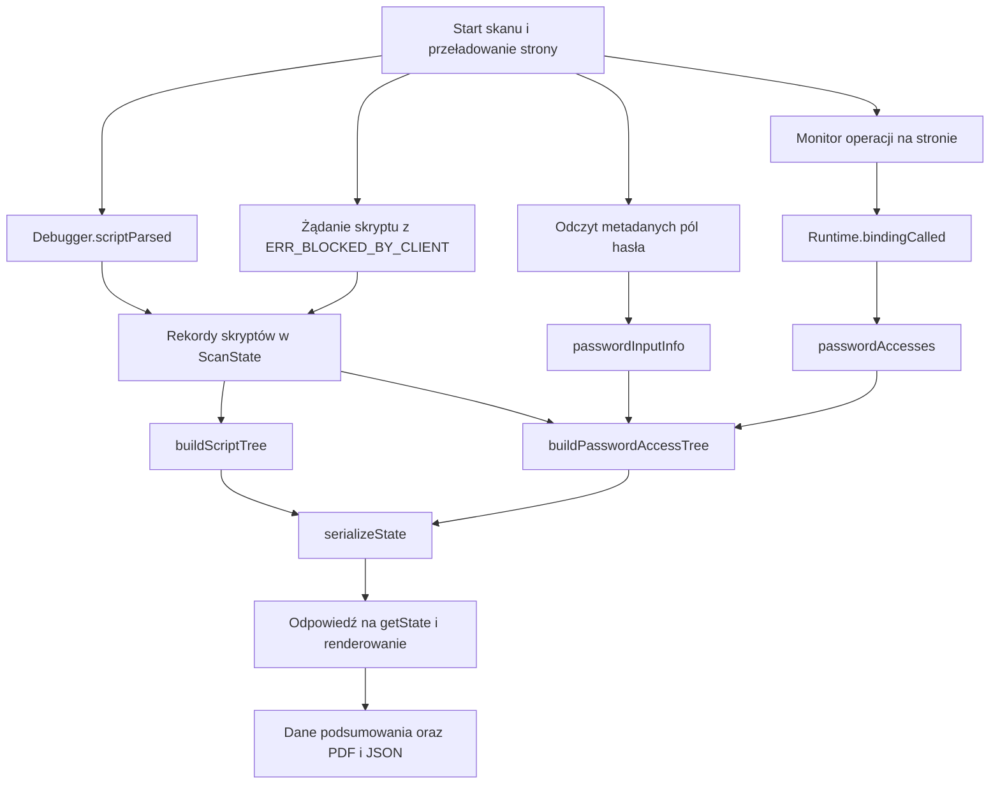

# Przepływ domen zewnętrznych i pól hasła

Ten przewodnik pokazuje, jak zdarzenie w badanej karcie staje się rekordem,
grupą domeny i wynikiem w oknie rozszerzenia lub raporcie. Warto najpierw
przeczytać [mapę działania wtyczki](README.md).

Rozszerzenie zbiera trzy różne informacje: jakie skrypty rozpoznała przeglądarka,
czy strona zawiera pole hasła oraz jakie operacje skrypt wykonał przy tym polu.
Ich połączenie pozwala opisać możliwość dostępu albo zaobserwowaną operację.
Sama obecność obcej domeny nie dowodzi odczytu hasła ani wysłania go poza stronę.

## Mapa przepływu

Połączenia między funkcjami znajdują się w
[composition/background.js](../../src/composition/background.js).
Port oznacza tutaj przekazaną funkcję lub obiekt, a nie osobne połączenie sieciowe.

| Scenariusz biznesowy | Porty i odpowiedzialność techniczna |
| --- | --- |
| `createScanFlow` | `browser` włącza obserwację skryptów, instaluje monitor i przeładowuje stronę; realizuje go [scan-browser.js](../../src/technical/background/scan-browser.js). |
| `createPasswordObservationFlow` | `readPasswordInputs` odczytuje metadane przez CDP, `scheduler` uruchamia powtarzanie, a `clock` nadaje czas sprawdzenia. |
| `createScriptRecorder` i `createPasswordAccessRecorder` | Otrzymują `clock`, aby zapisywać czas obserwacji. Nie wywołują Chrome. |
| `registerExtensionListeners` | Odbiera zdarzenia Chrome i wywołuje odpowiednie funkcje biznesowe. |

## 1. Od skryptu do domeny zewnętrznej

[startScanWithReload](../../src/business/scanning/scan-flow.js) włącza między innymi
`Debugger.enable`, `Network.enable` i `Runtime.enable` przed przeładowaniem strony.
Zdarzenia docierają do `handleDebuggerEvent` w
[extension-events.js](../../src/technical/background/extension-events.js).
Funkcja pomija karty bez aktywnego stanu z `attached: true`.

Główna droga wygląda tak:

1. Chrome zgłasza `Debugger.scriptParsed` z adresem, identyfikatorem i metadanymi skryptu.
2. `handleScriptParsed` w [script-records.js](../../src/business/scanning/script-records.js)
   wywołuje `normalizeScript`, rozbiera URL i ustala klasyfikację względem badanej strony.
3. Rekord trafia do `state.scripts` oraz, jeśli ma identyfikator, do `state.scriptsById`.
   Ponowne zdarzenie o tym samym `scriptId` aktualizuje istniejący rekord.
4. Przy odczycie wyniku `getVisibleScripts` wybiera rekordy, a
   `buildScriptTree` w [script-report.js](../../src/business/scanning/script-report.js)
   grupuje je według klasyfikacji i głównej domeny.

`Debugger.scriptParsed` oznacza rozpoznanie kodu przez przeglądarkę. Ten sygnał
nie potwierdza wykonania konkretnej funkcji ani odczytu pola hasła.

### Które skrypty są widoczne

[classifyScript](../../src/business/scanning/script-classification.js) stosuje reguły
w poniższej kolejności. Przykładowa badana strona to `https://konto.sklep.pl/login`.
Pochodzenie, zapisane jako `origin`, obejmuje protokół, host i port.

| Klasyfikacja | Przykład lub warunek | Widoczność w wynikach domen i haseł |
| --- | --- | --- |
| `browser/internal` | Kod rozszerzenia lub wewnętrzny kod przeglądarki. | Pomijany. |
| `inline/eval/blob` | Kod osadzony, `eval`, `blob:`, `data:` lub brak rozpoznanego hosta i pochodzenia. | Pomijany. |
| `first-party-origin` | `https://konto.sklep.pl/app.js`, czyli to samo pochodzenie. | Pomijany. |
| `same-site` | `https://static.sklep.pl/app.js`, czyli ta sama główna domena `sklep.pl`. | Pomijany. |
| `third-party` | `https://cdn.analityka.net/widget.js`, czyli inna główna domena. | Uwzględniany. |

Filtry dotyczą wyników udostępnianych przez `serializeState`; wewnętrzna tablica
`state.scripts` może zawierać również rekordy ukrytych kategorii.
Dwa różne `scriptId` z tym samym URL pozostają dwoma rekordami skryptów.
Licznik skryptów jest więc liczbą rekordów, a nie zawsze liczbą unikalnych adresów.

Grupa ma klucz taki jak `third-party:analityka.net`. Skrypty z
`cdn.analityka.net` i `api.analityka.net` należą do jednej grupy.
Jej `count` liczy wszystkie rekordy, a `blockedCount` tylko zablokowane lokalnie.
`thirdPartyDomainsCount` liczy unikalne główne domeny.

### Osobna droga skryptu zablokowanego lokalnie

Skrypt zatrzymany przed załadowaniem może nie wywołać `Debugger.scriptParsed`.
Dlatego [network-events.js](../../src/technical/background/network-events.js)
łączy zdarzenia sieciowe po `requestId`:

1. `Network.requestWillBeSent` zapisuje URL i typ `Script` w `state.scriptRequests`.
2. `Network.loadingFailed` dopisuje `errorText` oraz `blockedReason` i wywołuje
   `addBlockedThirdPartyScript`.
3. Rekord powstaje tylko dla zasobu `Script`, z URL, błędem zawierającym
   `ERR_BLOCKED_BY_CLIENT` i klasyfikacją `third-party`.
4. Trafia do `state.scripts` z `type: 'blocked'`, `blockedByClient: true` i
   identyfikatorem zaczynającym się od `blocked:`. `state.blockedScriptsByUrl`
   scala kolejne takie błędy dla tego samego URL.

Te rekordy pozostają w wynikach jako informacja o skrypcie, który mógłby działać
bez lokalnej blokady. Inne błędy pobierania nie tworzą tego rodzaju rekordu.
Załadowanie oraz blokada tego samego URL w różnych momentach mogą pozostawić
osobne rekordy; implementacja nie scala tych dwóch dróg w jeden wynik.

## 2. Od obecności pola hasła do możliwości dostępu

`createPasswordObservationFlow` w
[password-observation-flow.js](../../src/business/scanning/password-observation-flow.js)
uruchamia `pollPasswordInputInfo` od razu po starcie odpytywania, a następnie co
1000 ms. Dodatkowymi wyzwalaczami są `Page.domContentEventFired`,
`Page.loadEventFired` oraz obsługa `getState` dla podłączonej karty.
`passwordPollInFlight` zapobiega nakładaniu się odczytów.

Port `readPasswordInputs` wykonuje `Runtime.evaluate` z
`document.querySelectorAll('input[type="password"]')`. Zwraca liczbę pól i metadane
pierwszych 20: między innymi `id`, `name`, `autocomplete` i `placeholder`.
Nie odczytuje ich wartości. Wynik zapisuje w `state.passwordInputInfo`:

| Pole stanu | Znaczenie |
| --- | --- |
| `hasPasswordInputs` | Czy ostatni udany odczyt znalazł przynajmniej jedno pole. |
| `hasEverPasswordInputs` | Czy udany odczyt w bieżącym dokumencie znalazł pole; pozostaje prawdziwe po zniknięciu formularza. |
| `count` i `inputs` | Ostatnia liczba pól i lista ich metadanych. |
| `lastChecked` | Czas ostatniej próby sprawdzenia. |
| `error` | Błąd ostatniej nieudanej próby; wcześniejsze dane pozostają wtedy zachowane. |
| `frameId` i `documentRevision` | Powiązanie wyniku z główną ramką i generacją dokumentu; spóźniony wynik po nawigacji jest odrzucany. |

[buildPasswordAccessTree](../../src/business/scanning/password-report.js) łączy
obecność pola teraz lub wcześniej w bieżącym dokumencie z kontekstem wykonania
skryptu. [password-context.js](../../src/business/scanning/password-context.js)
uznaje domyślny kontekst głównej ramki za dostępny. Dla innych znanych kontekstów
port `readPasswordContextAccess` sprawdza dostęp do `window.top.document`.
Odmowa `SecurityError` wyklucza potencjalny dostęp do hasła rodzica; brak wyniku
oznacza `accessScope: 'unknown'`. Próba nie odczytuje wartości żadnego pola.

Dostępny kontekst daje wpis `observed: false`, `count: 0`,
`accessScope: 'accessible'` i `kind: 'potential.password-value-capability'`.
Nieustalony kontekst ma `kind: 'potential.password-access-unknown'` i pusty `target`.
Usunięcie kontekstu lub nawigacja unieważnia ocenę; spóźnione odpowiedzi CDP
nie mogą zmienić stanu nowego dokumentu. Zaobserwowane zdarzenia monitora są
zachowywane niezależnie od potencjalnego dostępu do głównego dokumentu.

Wpis potencjalny wskazuje pierwsze pole z ostatniego odczytu, a gdy lista jest
pusta, ma pusty `target`. Nie stanowi więc dowodu, że skrypt wybrał właśnie to
pole. Dla skryptu zablokowanego lokalnie rodzaj wpisu to
`blocked-by-client.third-party-script`, nadal z `observed: false` i `count: 0`.

## 3. Od operacji skryptu do obserwacji

Przed przeładowaniem strony adapter instaluje funkcję komunikacyjną
`__networkAssetInspectorPasswordAccess` przez `Runtime.addBinding` oraz
[monitor](../../src/technical/background/password-monitor.js) przez
`Page.addScriptToEvaluateOnNewDocument`. Nazwa funkcji jest wspólna dla obu stron
w [protocol.js](../../src/technical/background/protocol.js).

Monitor opakowuje wybrane metody przeglądarki, zachowując wywołanie oryginalnej
operacji. Nie skanuje tekstu wszystkich skryptów w poszukiwaniu podejrzanych słów.

| Rodzaj obserwacji | Co ją wywołuje | Co można z niej wnioskować |
| --- | --- | --- |
| `password.value.get` | Wywołanie opakowanej funkcji odczytującej `input.value` dla pola hasła. | Skrypt sięgnął po wartość pola. |
| `password.value.set` | Wywołanie opakowanej funkcji zapisującej `input.value` dla pola hasła. | Skrypt próbował ustawić wartość pola. |
| `password.type.get`, `password.type.set` | Odczyt typu hasła lub ustawienie typu na `password`. | Operacja na typie pola; nie dowodzi odczytu wartości. |
| `password.addEventListener` | Dodanie funkcji obsługi zdarzenia bezpośrednio na polu hasła. | Zainteresowanie zdarzeniami tego elementu; nie dowodzi odczytu wartości. |
| `password.querySelector`, `password.querySelectorAll`, `password.getElementById`, `password.getElementsByName`, `password.getElementsByTagName`, `password.getElementsByClassName` | Wybrane metody `Document` zwracają pole hasła. | Skrypt uzyskał element lub kolekcję zawierającą takie pole. |
| `password.element.querySelector`, `password.element.querySelectorAll` | Wybrane metody `Element` zwracają pole hasła. | Taki sam sygnał, ale wyszukiwanie rozpoczęło się od konkretnego elementu. |

Monitor przekazuje JSON zawierający `kind`, `detail`, metadane `target`, URL strony,
czas i stos wywołań. W danych nie ma odczytanej ani ustawianej wartości hasła.
Oryginalna funkcja odczytu zwraca wartość kodowi strony; rozszerzenie jej nie zapisuje.
Zgłoszenie odczytu lub zapisu wartości powstaje przed wywołaniem oryginalnej funkcji, więc
sam rekord nie potwierdza jej pomyślnego zakończenia, treści pola ani wysłania danych.

Chrome dostarcza `Runtime.bindingCalled`. `readPasswordObservation` sprawdza
nazwę funkcji komunikacyjnej i odczytuje JSON. Następnie
`recordPasswordAccess` w [password-access.js](../../src/business/scanning/password-access.js):

1. Odczytuje ramki stosu i wybiera pierwszą, której URL nie wskazuje monitora.
2. Z tego URL ustala skrypt, domenę i klasyfikację względem badanej strony.
3. Tworzy klucz z rodzaju operacji, URL skryptu, wiersza, kolumny, opisu `detail`
   oraz `target.id` i `target.name`.
4. Nową obserwację zapisuje w `state.passwordAccesses` i `state.passwordAccessesByKey`.
   Powtórzenie tego samego klucza zwiększa `count` i aktualizuje `lastSeen`.

Czasy `firstSeen` i `lastSeen` pochodzą z zegara skanera. Zachowany rekord nie używa
czasu `timestamp` przesłanego przez stronę. `stackFrames` przechowuje do 20 ramek.
`executionContextId` pozostaje metadanymi; nie jest częścią klucza scalania obserwacji.

## 4. Interpretacja i liczniki na konkretnym przykładzie

Przyjmijmy stronę `https://konto.sklep.pl/login`, jedno pole
`<input type="password" id="haslo" name="password">` oraz jeden załadowany skrypt
`https://cdn.analityka.net/widget.js`. Odpytywanie wykryło pole, a skrypt został
sklasyfikowany jako `third-party`.

| Moment | Zawartość grupy `third-party:analityka.net` | Liczniki drzewa haseł |
| --- | --- | --- |
| Brak operacji monitora | Jeden wpis potencjalny; `potentialCount: 1`, `eventCount: 0`. | `potentialScripts: 1`, `totalAccesses: 0`, `totalValueAccesses: 0`. |
| Skrypt raz wywołuje `document.querySelector('#haslo')` | Jeden wpis obserwowany rodzaju `password.querySelector`; `domSignalCount: 1`, `potentialCount: 0`. | `potentialScripts: 0`, `totalAccesses: 1`, `totalValueAccesses: 0`. |
| Skrypt dwa razy czyta `.value` z tej samej pozycji w kodzie | Dochodzi jeden rekord `password.value.get` z `count: 2`; grupa ma `eventCount: 3`, `valueAccessCount: 2`, `domSignalCount: 1`. | `totalAccesses: 3`, `totalValueAccesses: 2`, `valueAccessDomainsCount: 1`. |

Przykład zakłada, że kolejne odczyty nie powtarzają wyszukiwania pola. Gdy kod
przy każdym odczycie ponownie wywołuje `querySelector`, zwiększy się również
licznik zdarzeń DOM.

Każda widoczna obserwacja danego URL, także samo wyszukanie elementu, usuwa potrzebę
tworzenia dla niego wpisu potencjalnego. Odpowiada za to `observedScriptKeys`.
Jest to zastąpienie przypuszczenia konkretną obserwacją, ale sygnał DOM nadal
nie staje się odczytem wartości. Reguła
[isPasswordValueAccess](../../src/business/scanning/password-rules.js) zalicza do
odczytów lub zapisów wyłącznie `password.value.get` i `password.value.set`.

W osobnym wariancie ten sam skrypt zostaje zablokowany przed załadowaniem i nie ma
obserwacji monitora. Grupa ma wtedy `blockedCount: 1`, `potentialCount: 0`,
`eventCount: 0` i `unknownCount: 1`, ponieważ zablokowany skrypt nie ma ustalonego
kontekstu wykonania. `potentialScripts` liczy tylko dostępne konteksty,
a `unknownScripts` i `unknownDomainsCount` opisują niepewność. Grupa jest
`accessible`, gdy ma choć jeden znany dostęp; w przeciwnym razie jest `unknown`.

`buildPasswordAccessTree` grupuje wpisy tak samo jak drzewo skryptów: według
klasyfikacji i głównej domeny. `scriptCount` w grupie oraz `uniqueScripts` w drzewie
liczą unikalne URL lub zastępcze nazwy skryptów. `totalAccesses` sumuje `count`
obserwacji, a nie liczbę wierszy. Jedna grupa może jednocześnie zawierać
obserwowane, potencjalne i zablokowane skrypty o różnych adresach.

## 5. Jak wynik trafia do okna i raportu

[serializeState](../../src/business/scanning/state-snapshot.js) buduje
`scriptTree` i `passwordAccessTree` przy odczycie stanu. Potencjalne wpisy haseł
powstają wtedy w drzewie; nie są dopisywane do surowej tablicy `state.passwordAccesses`.
Wynik zawiera także widoczne `scripts` i `passwordAccesses`.

Okno pobiera stan przez `getState`. `render` w
[popup-flow.js](../../src/business/popup/popup-flow.js) zapisuje `session.latestState`
i przekazuje drzewa do widoków:

- [scripts-view.js](../../src/technical/popup/scripts-view.js) pokazuje grupy domen,
  liczbę skryptów i liczbę lokalnie zablokowanych. Informacja o możliwości odczytu
  zdjęć pochodzi ze wspólnej oceny zdjęć i CORS, przypisanej grupom zewnętrznym;
  nie jest obserwacją odczytu zdjęcia przez konkretny skrypt.
- [password-view.js](../../src/technical/popup/password-view.js) pokazuje liczbę
  bieżących pól, liczbę grup domen i `totalValueAccesses`. Grupy z ustalonym
  dostępem otrzymują etykietę `KRYTYCZNE`, a pozostałe `Dostęp nieustalony`.
  Sam kolor nie rozstrzyga, czy zaobserwowano odczyt.
- [getReportStats](../../src/business/popup/summary.js) przekazuje do raportu
  `scriptTree.thirdPartyGroups` oraz `passwordAccessTree.groups`.
  Zasady końcowej oceny opisuje [przewodnik podsumowania ryzyka](risk-assessment.md).

PDF rozwija szczegóły: [sekcja domen](../../src/technical/report/sections/scripts.js)
wypisuje URL i stan blokady, a
[sekcja haseł](../../src/technical/report/sections/passwords.js) rodzaj operacji,
liczbę wystąpień, lokalizację w kodzie, czas i metadane elementu.
`getPasswordEvidenceLabel` w [rules.js](../../src/business/report/rules.js)
rozróżnia lokalną blokadę, możliwość dostępu, odczyt wartości, zapis wartości i
pozostały dostęp do DOM. Pełniejsze grupy trafiają również do
[danych dowodowych JSON](../../src/business/report/evidence.js).
Tworzenie plików opisuje [przepływ raportu](report.md).

## Ograniczenia, które pomagają poprawnie czytać wynik

- Główna domena pochodzi z uproszczonego `getRegistrableDomain` w
  [urls.js](../../src/business/scanning/urls.js), z krótką listą złożonych końcówek.
  To nie jest pełna lista sufiksów publicznych; domeny wielodostępnych usług
  mogą zostać połączone w jedną grupę.
- Lista pól pochodzi z odpytywania `document` w domyślnym kontekście wykonania.
  Nie przechodzi przez wszystkie ramki ani drzewa cienia. Pole, które pojawi się
  i zniknie między odczytami, może nie ustawić `hasEverPasswordInputs`.
- Monitor obserwuje wymienione operacje, a nie wszystkie sposoby kontaktu z DOM.
  W kolekcji sprawdza do 25 elementów i zgłasza pierwsze znalezione pole hasła.
  Brak zdarzenia nie jest dowodem braku dostępu.
- Przypisanie do skryptu wynika ze stosu wywołań. Brak rozpoznawalnego URL może
  spowodować klasyfikację `inline/eval/blob` i ukrycie obserwacji w wynikach.
  Źródło własne lub tej samej głównej domeny również jest odfiltrowywane.
- Model potencjalnego dostępu sprawdza dostęp kontekstu do dokumentu rodzica,
  a nie faktyczne odczytanie hasła przez dany skrypt. Próba opisuje chwilę pomiaru.
  Nie są podłączane osobne targety OOPIF; konteksty i obserwacje z tych targetów
  pozostają poza zakresem skanu. Klasyfikacja domen odnosi się do głównej strony.
- Flaga `hasEverPasswordInputs` utrzymuje kontekst po zniknięciu pola. Możliwe są
  jednocześnie `passwordInputCount: 0` i niepuste grupy haseł. Nowy dokument lub
  ponowny start zeruje metadane pól; zatrzymanie zachowuje wynik i wyłącza odpytywanie.

## Gdy wynik wydaje się niepoprawny

| Objaw | Gdzie sprawdzić przepływ |
| --- | --- |
| Brak domeny, choć skrypt jest na stronie | Sprawdź zdarzenie `Debugger.scriptParsed`, `state.scripts`, adres badanej strony i `classification`. Kategoria `same-site` jest celowo ukryta. |
| Brak zablokowanego skryptu | Sprawdź wcześniejsze `Network.requestWillBeSent`, typ `Script`, URL oraz dokładny warunek `ERR_BLOCKED_BY_CLIENT`. Samo `blockedReason` nie wystarcza. |
| Pole jest widoczne, a licznik wynosi zero | Sprawdź `passwordInputInfo`, `lastChecked`, `error`, aktywne `attached` i kontekst dokumentu. Błąd odczytu pozostaje w stanie wewnętrznym; `serializeState` nie przekazuje pola `error` do drzewa. |
| Jest grupa krytyczna, ale zero odczytów | Sprawdź `observed`, `blockedByClient`, `kind`, `potentialCount` i `domSignalCount`. To może być możliwość dostępu albo sygnał DOM. |
| Rekord jest w stanie, ale nie widać grupy haseł | Sprawdź filtr klasyfikacji, kontekst i `accessScope`. Obserwowane zdarzenia są widoczne również bez pola w głównym dokumencie; potencjał kontekstu odizolowanego jest pomijany. |
| Licznik rośnie bez nowych wierszy | Sprawdź `count` i `lastSeen`: identyczne obserwacje są scalane według rodzaju, skryptu, pozycji w kodzie, opisu i oznaczeń pola. |

Wspólne kształty `ScriptRecord`, `PasswordAccess`, `PasswordInputInfo` i
`PasswordAccessTree` opisuje [types/scanning.js](../../types/scanning.js).
Czytając nowe zgłoszenie, warto przejść kolejno przez zdarzenie, rekord wewnętrzny,
filtr, grupę i funkcję widoku, zamiast zaczynać od koloru w interfejsie.
