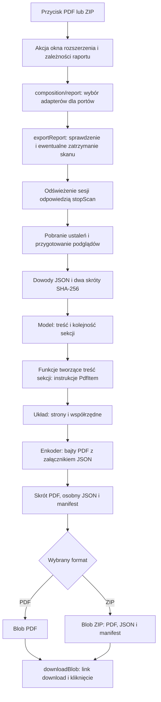
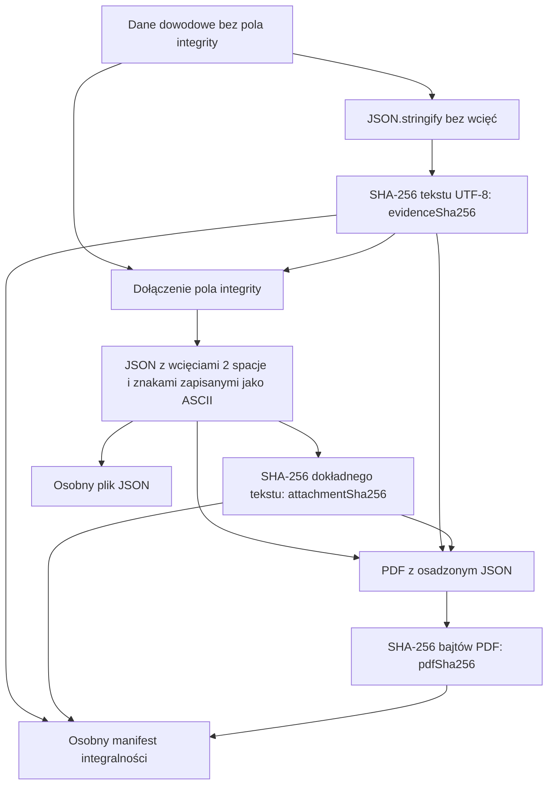

# Od przycisku do raportu PDF lub ZIP

Ten przewodnik prowadzi przez eksport dla osoby znającej JavaScript, `async`/`await` i DOM. Do zmiany tekstu raportu nie trzeba znać składni PDF ani ZIP. Zacznij od scenariusza [`exportReport`](../../src/business/report/export.js), a szczegóły formatów czytaj dopiero wtedy, gdy zmieniasz sposób zapisu pliku.

[Mapa przepływów](README.md).

Jeśli chcesz najpierw zrozumieć treść werdyktu, przeczytaj
[zasady oceny ryzyka](risk-assessment.md). Pochodzenie ustaleń o skryptach i hasłach
wyjaśnia [przepływ domen zewnętrznych i pól hasła](passwords-and-scripts.md).

## Cała droga

`Blob` w schemacie to przeglądarkowy obiekt przechowujący gotową zawartość pliku.



Diagram pokazuje udaną ścieżkę z zatrzymaniem aktywnego skanu. Jeśli skan już nie trwa, eksport pomija zatrzymanie i odświeżenie jego odpowiedzią. Anulowanie oraz błędy opisano na końcu.

| Etap | Funkcja, którą warto otworzyć | Co robi |
| --- | --- | --- |
| Kliknięcie | [`bindPopupEvents`](../../src/technical/popup/events.js) | Łączy przyciski z `exportImagesPdf` i `exportReportZip`. |
| Obsługa akcji | [`createReportActions`](../../src/business/popup/report-actions.js) | Wywołuje eksport i zamienia odrzuconą obietnicę na komunikat błędu. |
| Dane okna rozszerzenia | [`startPopup`](../../src/composition/popup.js), obiekt `reportDependencies` | Przekazuje funkcje odczytujące sesję, odświeżanie widoku, komunikaty i pobieranie pliku. |
| Połączenie warstw | [`createReportPorts`](../../src/composition/report.js) | Dołącza konkretne implementacje podglądów, serializacji, SHA-256, PDF i ZIP. |
| Scenariusz | [`exportReport`](../../src/business/report/export.js) | Wykonuje pięć opisanych kroków i zarządza `busy`. |
| Podglądy | [`prepareReportFindings`](../../src/business/report/prepare.js) | Dodaje lokalne JPEG do ustaleń o zdjęciach. |
| Dowody | [`prepareReportEvidence`](../../src/business/report/prepare.js) | Buduje dane dowodowe, tekst załącznika i dwa skróty JSON. |
| Dokument i pliki | [`createReportFiles`](../../src/business/report/files.js) | Tworzy model, PDF, osobny JSON i manifest integralności. |
| Wybór formatu | [`chooseReportDownload`](../../src/business/report/files.js) | Wybiera PDF albo pakuje przygotowane pliki do ZIP. |
| Pobranie | [`downloadBlob`](../../src/technical/popup/downloads.js) | Tworzy lokalny URL dla `Blob`, klika link z `download` i zwalnia URL. |

`exportImagesPdf` jest nazwą historyczną: eksportuje **cały raport**, w tym domeny zewnętrzne i pola hasła. [`report.js`](../../report.js) udostępnia funkcje z modułu kompozycji; nie zawiera osobnej implementacji raportu.

## Porty to przekazane funkcje

Scenariusz biznesowy nie wywołuje bezpośrednio Chrome ani DOM. Wywołuje metody obiektu `ports`, a [`createReportPorts`](../../src/composition/report.js) wskazuje ich implementacje. To zwykły obiekt JavaScript, bez kontenera zależności.

| Potrzeba scenariusza | Port | Skąd pochodzi implementacja |
| --- | --- | --- |
| Odczyt aktualnej sesji | `getLatestState`, `getReportStats`, `getSecuritySummary` | Funkcje odczytu stanu z `composition/popup.js`; ustalenia i podsumowanie oblicza [`summary.js`](../../src/business/popup/summary.js). |
| Zatrzymanie i odświeżenie | `stopScan`, `render` | `sendMessage('stopScan')` i `flow.render` z okna rozszerzenia. |
| Pytanie użytkownika | `confirmStopScan` | [`confirmStopScan`](../../src/technical/report/browser.js), czyli `window.confirm`. |
| Lokalny podgląd | `createImagePreview` | [`createReportPreviewJpeg`](../../src/technical/report/previews.js), czyli `Image` i `canvas`. |
| JSON i skróty | `serializeEvidencePayload`, `serializeEvidenceAttachment`, `hashText`, `hashFile` | [`serialization.js`](../../src/technical/report/serialization.js). |
| Treść dokumentu | `renderReportDocument` | [`renderReportDocument`](../../src/technical/report/document.js), który zwraca instrukcje, a nie gotowy PDF. |
| Gotowe pliki | `createPdf`, `createJsonFile`, `createTextFile`, `createArchive` | Enkoder PDF, funkcje tworzące `Blob` i zapis ZIP. |
| Interfejs i pobranie | `setBusy`, `setStatusText`, `downloadBlob` | Funkcje przekazane przez okno rozszerzenia. |

Kontrakty opisuje [`types/report.js`](../../types/report.js): `ReportDependencies` to wejście z okna rozszerzenia, a `ReportPorts` to pełen zestaw funkcji używany przez eksport. Typy w komentarzach JSDoc pomagają edytorowi; nie wykonują się w przeglądarce.

## Jak zmienia się kształt danych

Poniższe przykłady są **celowo skrócone**. Pokazują wybrane pola i relacje; nie są kompletnymi rekordami, poprawnymi danymi testowymi ani gotowym kodem do wklejenia. Symbole takie jak `summary`, `context` i `attachmentText` oznaczają obiekty lub wartości z poprzednich etapów.

| Kształt | Powstaje w | Znaczenie |
| --- | --- | --- |
| `ReportStats` | [`getReportStats`](../../src/business/popup/summary.js) | Zdjęcia widoczne w oknie rozszerzenia, grupy skryptów i haseł oraz drzewa danych skanu. Nazwa obejmuje ustalenia, nie tylko liczniki. |
| `PreparedReportStats` | [`prepareReportFindings`](../../src/business/report/prepare.js) | Te same kategorie danych; każde zdjęcie ma dodatkowo `reportPreviewJpeg` lub `null`. |
| `ReportDraft` → `Report` | [`exportReport`](../../src/business/report/export.js) | Ustalenia, podsumowanie, czas i ID; po przygotowaniu dowodów także `evidence`. |
| `EvidencePayload` → załącznik | [`buildEvidencePayload`, `attachEvidenceIntegrity`](../../src/business/report/evidence.js) | Metadane i ustalenia bez lokalnych podglądów; następnie dodatkowe pole `integrity`. |
| `ReportEvidence` | [`prepareReportEvidence`](../../src/business/report/prepare.js) | Dokładny tekst załącznika i dwa skróty opisane poniżej. |
| `ReportModel` | [`createReportModel`](../../src/business/report/model.js) | Wspólny kontekst i uporządkowana lista sekcji. |
| `PdfItem[]` | [`renderReportDocument`](../../src/technical/report/document.js), [`pushPdfLine` i pozostałe funkcje `items.js`](../../src/technical/report/pdf/items.js) | Tekst, bloki, obrazy, linie i żądania przejścia na nową stronę. |
| `PdfPages` | [`paginatePdfItems`](../../src/technical/report/pdf/layout.js) | Tablica stron; każda strona to tablica elementów z obliczonym położeniem. |
| `Blob` PDF | [`createPdfBlob`](../../src/technical/report/pdf/encoder.js) | Gotowe bajty dokumentu, wraz z osadzonym JSON. |
| `ReportFiles` → wybrany plik | [`createReportFiles`, `chooseReportDownload`](../../src/business/report/files.js) | PDF, JSON i manifest; następnie nazwa, plik do pobrania i komunikat. |

Ustalenia i lokalny podgląd:

```js
// ReportStats — pominięto większość pól zdjęcia i pozostałe kategorie danych.
{ imageFindings: [{ url: 'https://example.test/photo.jpg' }], scriptGroups: [] }

// PreparedReportStats — podgląd może być null, jeśli nie udało się go utworzyć.
{ imageFindings: [{ url: 'https://example.test/photo.jpg',
    reportPreviewJpeg: { dataUrl: 'data:image/jpeg;base64,...', width: 720, height: 480 }
}] }

// Report — evidence dodawane jest dopiero po przygotowaniu i serializacji dowodów.
{ reportStats, summary, generatedAt: new Date(), reportId: 'RODO-example.test-...',
  evidence: { evidenceSha256: '...', attachmentText: '...', attachmentSha256: '...' } }
```

`prepareReportFindings` używa `Promise.all`, więc czeka na podglądy wszystkich zdjęć i zachowuje ich kolejność w tablicy. [`createReportPreviewJpeg`](../../src/technical/report/previews.js) korzysta z lokalnego `previewDataUrl`, nie pobiera zdjęcia z jego adresu HTTP. Brak podglądu daje `null`. [`cloneEvidenceValue`](../../src/technical/report/serialization.js) usuwa `previewDataUrl` i `reportPreviewJpeg` z kopii umieszczanej w JSON; podglądy służą ilustracji PDF.

Do raportu trafiają te same zakwalifikowane zdjęcia JPEG/JPG i PNG co do widoku
okna rozszerzenia. Źródłowy PNG jest rysowany na białym tle w `canvas`, a jego
lokalny podgląd zapisywany jako JPEG obsługiwany przez enkoder PDF. Przezroczyste
obszary PNG mają więc w PDF białe tło. Zmiana formatu dotyczy wyłącznie ilustracji:
nie zmienia metadanych źródłowego zdjęcia, wyniku porównania ani długości i skrótów
SHA-256 oryginalnych bajtów obu odpowiedzi.

Od modelu do strony:

```js
// ReportModel — rzeczywista lista obejmuje też scope, images, scripts i passwords.
{ context, sections: [{ kind: 'cover', reportStats, summary }, { kind: 'method' }] }

// PdfItem[] — wybrane pola jednego wiersza; jeszcze bez numeru strony i pozycji.
[{ kind: 'text', text: 'Raport', size: 10, font: 'bold', color: [0, 0, 0] }]

// PdfPages — zewnętrzna tablica zawiera strony, wewnętrzna ich elementy.
[[{ kind: 'text', text: 'Raport', size: 10, font: 'bold', color: [0, 0, 0],
    baseline: 700 }]]

// ReportFiles i wynik wyboru pobrania — pdf/json/integrity to obiekty Blob.
{ names, pdf, json, integrity, generatedAt }
{ filename: names.pdf, file: pdf, statusText: 'Pobrano raport PDF ...' }
```

Kontrakty instrukcji i położeń znajdują się w [`types/pdf.js`](../../types/pdf.js). `kind` rozróżnia warianty elementu. Paginacja dodaje np. `baseline` tekstu albo `top` obrazu i usuwa z wyniku instrukcje `page-break`, które posłużyły do zakończenia stron. [`renderPdfItem`](../../src/technical/report/pdf/drawing.js) zamienia rozmieszczone elementy na polecenia PDF, a enkoder zapisuje obiekty, zasoby, metadane i tabelę pozycji bajtowych.

## Dwa skróty JSON i skrót PDF

SHA-256 liczy skrót **konkretnych bajtów**. Ten sam obiekt zapisany z innymi wcięciami, kolejnością pól lub innym kodowaniem znaków może mieć inny skrót. Eksport używa trzech nazw, bo obejmują różne dane.



| Nazwa | Dokładne wejście do SHA-256 | Gdzie trafia skrót |
| --- | --- | --- |
| `evidenceSha256` | `JSON.stringify(evidencePayload)`, bez dodatkowego formatowania, zakodowane przez `TextEncoder` jako UTF-8. Obiekt danych nie zawiera jeszcze pola `integrity`. | Do `integrity.sha256` załącznika, kontekstu PDF i końcowej części manifestu. |
| `attachmentSha256` | Dokładny `attachmentText`: `JSON.stringify(attachment, null, 2)`, po zastąpieniu znaków spoza ASCII sekwencjami `\uXXXX`, następnie UTF-8. | Do kontekstu PDF oraz wiersza manifestu dotyczącego pliku JSON. |
| `pdfSha256` | Bajty gotowego `Blob` PDF, odczytane przez `arrayBuffer()`. PDF już zawiera załącznik JSON. | Do wiersza manifestu dotyczącego pliku PDF. |

Kolejność w [`prepareReportEvidence`](../../src/business/report/prepare.js) odpowiada poniższemu skrótowi kodu. Nazwy funkcji technicznych rozwijają tu porty używane w rzeczywistym scenariuszu:

```js
const payloadText = stringifyEvidencePayload(evidencePayload); // JSON.stringify(value)
const evidenceSha256 = await sha256Text(payloadText);
const attachment = attachEvidenceIntegrity(evidencePayload, evidenceSha256);
const attachmentText = stringifyAsciiJson(attachment); // wcięcia i sekwencje Unicode
const attachmentSha256 = await sha256Text(attachmentText);
// Dopiero createReportFiles buduje PDF, a potem liczy sha256Blob(pdf).
```

Pierwszy skrót jest liczony przed dodaniem `integrity`, aby nie obejmował własnej wartości. Drugi dotyczy całego tekstu z tym polem. Dokładnie ten sam `attachmentText` jest osadzany w PDF i przekazywany do [`createJsonBlob`](../../src/technical/report/serialization.js). Zapis znaków spoza ASCII jako sekwencji Unicode umożliwia enkoderowi PDF użycie długości ciągów JavaScript jako długości bajtów dla tej zawartości.

Przy sprawdzaniu skrótu pliku JSON lub PDF licz SHA-256 z otrzymanych bajtów, bez parsowania i ponownego formatowania. Przy sprawdzaniu wewnętrznego `integrity.sha256` trzeba natomiast sparsować JSON, usunąć wyłącznie jego główne pole `integrity` i użyć zwykłego `JSON.stringify` bez wcięć oraz bez dodatkowego zamieniania znaków na sekwencje ASCII. Zachowaj kolejność pozostałych pól; nie sortuj ich. Te dwa sposoby odpowiadają dwóm różnym skrótom, a nie zamiennym sposobom sprawdzania jednego skrótu.

[`buildIntegrityManifest`](../../src/business/report/evidence.js) tworzy osobny plik tekstowy już po obliczeniu skrótu PDF. ZIP zawiera PDF, osobny JSON i ten manifest, w takiej kolejności. [`createZipBlob`](../../src/technical/report/zip.js) zapisuje archiwum bez kompresji; jego CRC-32 jest dodatkowym elementem formatu ZIP, odrębnym od opisanych skrótów SHA-256. Wybór samego PDF również przechodzi przez przygotowanie całego `ReportFiles`, ale pobiera tylko PDF. Manifest opisuje spójność danych; nie jest podpisem cyfrowym ani zaufanym znacznikiem czasu.

## Kiedy eksport odczytuje bieżący stan

`getLatestState()` odczytuje sesję okna rozszerzenia w chwili wywołania. `getReportStats()` i `getSecuritySummary()` też korzystają z tej sesji. Sama funkcja odczytująca stan nie wysyła nowego zapytania do Chrome. Po `await stopScan()` eksport wywołuje `render(stoppedState)`, co aktualizuje sesję i widok; dopiero później pobiera ustalenia.

| Moment | Co jest odczytywane |
| --- | --- |
| Wejście do eksportu | Bieżący stan do decyzji, czy zapytać o zatrzymanie. |
| Po ewentualnym `stopScan` i `render` | Bieżący stan do sprawdzenia dostępności danych oraz `getReportStats()` jako źródło ustaleń. |
| Po `await prepareReportFindings(...)` | Czas generowania, aktualne podsumowanie i domena użyta w ID raportu. Ustalenia nie są pobierane ponownie. |
| Początek `prepareReportEvidence` | Bieżące metadane skanu przez `getLatestState()` i manifest rozszerzenia; ustalenia i podsumowanie są już przekazane w `report`. |
| Początek `createReportFiles`, po obliczeniu skrótów JSON | Nazwa pliku i bieżący adres strony do kontekstu dokumentu. |
| Renderowanie sekcji `scope` | Kolejny odczyt bieżącego stanu i manifestu przez [`renderReportDocument`](../../src/technical/report/document.js). |
| Wywołanie `createPdf` | Aktualna domena do metadanych PDF; czas i ID pochodzą z przygotowanego `report`. |

To nie jest jeden głęboko zamrożony obraz całej sesji. Zatrzymanie skanu poprzedza przygotowanie raportu, ale odczyty są celowo rozłożone w czasie, a podglądy i skróty wymagają `await`. `getReportStats()` kopiuje wierzchnie obiekty zdjęć, natomiast grupy i drzewa pobiera z sesji; nie wykonuje głębokiej kopii wszystkich danych. Przy modyfikacji przepływu nie przenoś wywołań funkcji odczytujących stan przed `await` ani nie zastępuj ich jednym odczytem bez sprawdzenia wpływu na zachowanie.

## Gdzie wprowadzać typowe zmiany

| Chcesz zmienić | Zacznij tutaj |
| --- | --- |
| Tekst lub pola konkretnej sekcji PDF | [`sections/cover.js`](../../src/technical/report/sections/cover.js), [`scope.js`](../../src/technical/report/sections/scope.js), [`images.js`](../../src/technical/report/sections/images.js), [`scripts.js`](../../src/technical/report/sections/scripts.js), [`passwords.js`](../../src/technical/report/sections/passwords.js), [`method.js`](../../src/technical/report/sections/method.js). |
| Werdykt współdzielony z oknem rozszerzenia | [`riskCopy`](../../src/business/popup/summary.js); poziom pilności raportu ustala [`reportPriority`](../../src/business/report/rules.js). |
| Kolejność lub zestaw sekcji | [`createReportModel`](../../src/business/report/model.js); obsługę rodzaju sekcji dobiera [`renderReportDocument`](../../src/technical/report/document.js). |
| Pola pełnego JSON i pomijanie podglądów | [`buildEvidencePayload`, `shouldOmitEvidenceField`](../../src/business/report/evidence.js). Zmiana danych lub kolejności pól wpływa na skrót danych dowodowych. |
| Kolory, marginesy i formatowanie elementów | [`theme.js`](../../src/technical/report/pdf/theme.js), [`items.js`](../../src/technical/report/pdf/items.js); położenia i podział stron — [`layout.js`](../../src/technical/report/pdf/layout.js). |
| Nazwy i zestaw pobieranych plików | [`reportFileNames`](../../src/business/report/model.js), [`getPdfReportFilename`](../../src/business/popup/filenames.js) oraz [`chooseReportDownload`](../../src/business/report/files.js). |
| Sposób zapisu PDF lub ZIP | Dopiero tutaj: [`encoder.js`](../../src/technical/report/pdf/encoder.js), [`drawing.js`](../../src/technical/report/pdf/drawing.js) lub [`zip.js`](../../src/technical/report/zip.js). |

Pomocnicze [`buildEvidencePayload` w `composition/report.js`](../../src/composition/report.js) i [`getFindingReportItems` w `document.js`](../../src/technical/report/document.js) zachowują wejścia do kontroli zgodności. Główna ścieżka eksportu wywołuje biznesowy `buildEvidencePayload` przez `prepareReportEvidence` oraz funkcję tworzącą instrukcje dokumentu przez `createReportFiles`; nie trzeba przechodzić przez te funkcje pomocnicze, aby zrozumieć kliknięcie przycisku.

## Anulowanie, błędy i `busy`

| Sytuacja | Zachowanie |
| --- | --- |
| Użytkownik odmawia zatrzymania aktywnego skanu | Eksport ustawia komunikat, że raport nie powstał, i wraca przed `setBusy(true)`. Skan nie jest zatrzymywany przez tę akcję. |
| Zatrzymanie zostaje potwierdzone | Eksport ustawia `busy`, czeka na `stopScan`, następnie przekazuje odpowiedź do `render`. |
| `stopScan` odrzuca obietnicę | Lokalny `catch` zeruje `busy` i przekazuje błąd dalej. |
| Brakuje kontekstu do raportu według `hasReportData` | Eksport zeruje `busy` i wraca przed przygotowaniem plików. |
| Brakuje lokalnego podglądu lub nie da się go utworzyć w obsługiwanej ścieżce | Adapter zwraca `null`; sekcja zdjęcia pokazuje informację o braku podglądu. Pozostałe dowody nadal mogą trafić do raportu. |
| Przygotowanie dowodów, dokumentu lub archiwum zgłasza błąd | `finally` w `exportReport` zeruje `busy`; [`createReportActions`](../../src/business/popup/report-actions.js) przechwytuje błąd, ustawia komunikat odpowiedni dla PDF lub ZIP i również zeruje `busy`. |
| Eksport się udaje | `downloadBlob` uruchamia pobieranie, scenariusz ustawia komunikat sukcesu, a `finally` zeruje `busy`. |

`downloadBlob` jest funkcją synchroniczną inicjującą pobranie przez przeglądarkę. Nie czeka na potwierdzenie, że użytkownik zapisał plik na dysku. Przepływ kończy się po uruchomieniu tej operacji.
