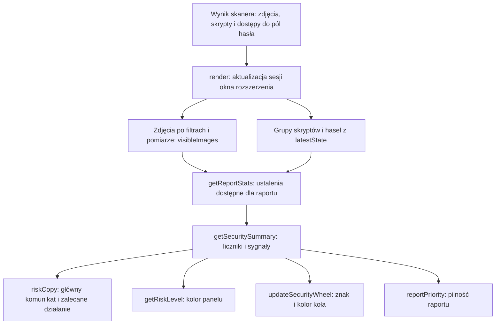

# Od ustaleń do oceny ryzyka

Ocena powstaje z aktualnych danych skanu. Kod najpierw wybiera i grupuje ustalenia,
potem oblicza kilka różnych liczników. Na ich podstawie wybiera komunikat,
kolory widoku i poziom pilności raportu. Nie oblicza punktowej oceny bezpieczeństwa.

[Mapa przepływów](README.md) · [Skanowanie zdjęć](scanning.md) ·
[Domeny zewnętrzne i pola hasła](passwords-and-scripts.md) · [Tworzenie raportu](report.md).

## Droga danych



1. [`serializeState`](../../src/business/scanning/state-snapshot.js) przygotowuje
   dane skanera, w tym `scriptTree` i `passwordAccessTree`.
2. [`render`](../../src/business/popup/popup-flow.js) zapisuje odpowiedź jako
   `session.latestState` i buduje `session.visibleImages`.
3. [`getReportStats`](../../src/business/popup/summary.js) pobiera zdjęcia z
   `visibleImages`, grupy domen z `scriptTree.thirdPartyGroups` i grupy hasła z
   `passwordAccessTree.groups`. Gdy nie ma drzew, używa pustych tablic.
4. [`getSecuritySummary`](../../src/business/popup/summary.js) oblicza liczniki.
   Typ wyniku, `SecuritySummary`, opisuje [`types/popup.js`](../../types/popup.js).
5. [`updateOverview`](../../src/technical/popup/overview.js) przepisuje gotową ocenę
   do elementów strony. Wybór reguł należy do warstwy biznesowej; DOM i kolory
   należą do warstwy technicznej.

Podsumowanie przelicza się przy każdym `render`, także po zakończeniu pomiaru
zdjęcia. Zmiana zakładki nie ogranicza oceny do tej zakładki: podsumowanie nadal
obejmuje wszystkie trzy rodzaje ustaleń w sesji.

## Co jest liczone

### Zdjęcia, domeny i zdarzenia mają inne jednostki

| Licznik w `SecuritySummary` | Jednostka i źródło |
| --- | --- |
| `improperAuthorizationImages` | Liczba zdjęć w `session.visibleImages`. |
| `cacheIssues` | Liczba tych samych widocznych zdjęć z flagą braku `no-store`. |
| `googleIssues` | Liczba tych samych widocznych zdjęć z flagą braku wykrytej blokady indeksowania przez Google. Nie jest liczbą zdjęć znalezionych w wynikach wyszukiwarki. |
| `thirdPartyDomains` | Liczba domen zewnętrznych w `scriptTree.thirdPartyDomainsCount`. |
| `thirdPartyScripts` | Liczba rekordów skryptów zewnętrznych w `scriptTree.thirdPartyScriptsCount`. |
| `corsPixelDomains` | Liczba grup domen zewnętrznych z możliwością odczytu pikseli przez co najmniej jeden ustalony kontekst wykonania. |
| `corsPixelUnknownDomains` | Liczba grup z co najmniej jednym skryptem o nieustalonym dostępie do zdjęć. Grupa może występować również w `corsPixelDomains`. |
| `corsPixelImages` | Liczba unikalnych zdjęć dostępnych co najmniej jednemu ustalonemu kontekstowi skryptu zewnętrznego (`thirdPartyCorsPixelAccessImageCount`). Starsze migawki bez tego licznika zachowują wartość z globalnego `corsPixelAccess.imageCount`. |
| `passwordDomains` | Liczba grup ze znanym dostępem (`accessible`), także samą możliwością dostępu. Starsze rekordy bez pola `accessScope` zachowują poprzednią interpretację. |
| `passwordUnknownDomains` | Liczba grup o nieustalonym dostępie (`unknown`); nie zwiększa licznika krytycznych domen hasła. |
| `passwordInputs` | Aktualna liczba wykrytych pól hasła. |
| `passwordEvents` | Suma `count` zaobserwowanych dostępów do pól hasła: wartości i pozostałych sygnałów DOM. |
| `passwordValueEvents` | Suma `count` zdarzeń `password.value.get` i `password.value.set`, czyli odczytów **i zapisów** wartości. |
| `passwordValueDomains` | Liczba grup, w których zaobserwowano co najmniej jeden odczyt lub zapis wartości. |

Zdjęcie trafia do `visibleImages` po przejściu
[`getFilteredImageRows`](../../src/business/popup/image-rules.js): musi mieć
akceptowany format JPEG/JPG lub PNG, ustalenie o braku poprawnej autoryzacji i udany pomiar
z dłuższym bokiem co najmniej 200 px. Zdjęcie oczekujące na pomiar jeszcze nie
zwiększa licznika. `latestState.imageCount` obejmuje szerszy zbiór skanera i może
być większy od `improperAuthorizationImages`.

[`buildScriptTree`](../../src/business/scanning/script-report.js) grupuje skrypty
według klasyfikacji i domeny głównej, np. skrypty z `cdn.example.test` i
`api.example.test` mogą należeć do jednej grupy `example.test`. Kilka rekordów
skryptów z tej grupy zwiększa `thirdPartyScripts`, ale domena nadal jest liczona
raz. Rekord skryptu zablokowanego lokalnie również może wejść do grupy; obecność
w liczniku nie dowodzi wykonania jego kodu.

Możliwość odczytu pikseli jest obliczana w
[`image-cors.js`](../../src/business/scanning/image-cors.js) na zdjęciach skanera
z ustaleniem `bodyComparison.improperAuthorization`. Ten etap nie stosuje filtra
wymiarów z okna rozszerzenia. `buildScriptTree` ustala origin żywego kontekstu
wykonania każdego skryptu i ocenia dostęp do zdjęć dla tego originu. Nie używa
domeny adresu pliku skryptu jako jego uprawnień ani nie przypisuje automatycznie
originu dokumentu głównego ramkom. Dla pozostałych kontekstów próba odczytuje
ich origin i sprawdza dostępność `top.document`, bez czytania treści zdjęć.
Dostęp do dokumentu głównego pozwala uwzględnić dodatkowo jego origin.
Ramka odizolowana od DOM strony głównej może
jednak samodzielnie odczytać zdjęcie z własnego originu albo dopuszczone przez CORS.

Podsumowanie grupy łączy zdjęcia dostępne co najmniej jednemu ustalonemu kontekstowi;
to samo zdjęcie jest liczone raz. `assessedScriptCount` opisuje liczbę skryptów
z pełnymi danymi o zakresie dostępu, `executionOrigins` zawiera ocenione originy,
a `unknownScriptCount` liczbę skryptów z niepełnymi danymi o zakresie dostępu
(przy istniejących zdjęciach podlegających ocenie). Znany origin może uzasadniać
własny dostęp nawet wtedy, gdy sprawdzenie dostępu do dokumentu głównego się
nie powiodło; wtedy możliwy i nieustalony dostęp występują równocześnie. Skrypt zablokowany lokalnie
nie ma potwierdzonego kontekstu i pozostaje nieustalony. Usunięty kontekst nie
uzyskuje potencjalnego dostępu. Nieustalony dostęp nie zwiększa `corsPixelDomains`
ani kategorii możliwości odczytu w `problemTypes`; jest widoczny w szczegółach
i PDF. Licznik obecności domen zewnętrznych działa niezależnie.

Globalne `scriptTree.corsPixelAccess` zachowuje ocenę dla strony głównej.
Grupy domen używają własnych ocen, a `thirdPartyCorsPixelAccessImageCount`
łączy dostępne im zdjęcia bez podwójnego liczenia między grupami. Jest to wniosek o technicznej możliwości
na podstawie originów i nagłówków, a nie obserwacja odczytu przez każdą domenę.
Skrypty z osobnych targetów OOPIF nadal wymagają osobnego podłączenia CDP,
którego rozszerzenie obecnie nie wykonuje.

[`buildPasswordAccessTree`](../../src/business/scanning/password-report.js) też
grupuje według klasyfikacji i domeny. Rekord dostępu może mieć `count: 5`, więc
jeden rekord w tablicy może oznaczać pięć zdarzeń. Rekord potencjalnej możliwości
ma `observed: false` i `count: 0`: zwiększa liczbę grup lub skryptów, ale nie
liczbę zaobserwowanych zdarzeń. Grupy mogą pozostać po zniknięciu pola hasła,
ponieważ skaner pamięta wcześniejszą obecność pól przez `hasEverPasswordInputs`
i zachowuje wcześniejsze obserwacje.

### `totalIssues` i `problemTypes` odpowiadają na różne pytania

`totalIssues` dodaje trzy liczby:

```text
totalIssues = improperAuthorizationImages + thirdPartyDomains + passwordDomains
```

To suma zdjęć oraz grup domen w dwóch kategoriach. Ta sama domena może wejść do
sumy raz jako domena skryptów i drugi raz jako domena przy polu hasła. Nie jest to
liczba unikalnych domen ani suma wszystkich liczników dowodów. `cacheIssues`,
`googleIssues`, `corsPixelImages` i liczba zdarzeń hasła nie są dodawane osobno.

`problemTypes` odpowiada na pytanie: „W ilu z sześciu kategorii występuje
co najmniej jeden sygnał?”. Każda poniższa kategoria wnosi najwyżej 1:

| Kategoria | Warunek zwiększenia `problemTypes` |
| --- | --- |
| Zdjęcia bez poprawnej autoryzacji | `improperAuthorizationImages > 0` |
| Brak `no-store` dla tych zdjęć | `cacheIssues > 0` |
| Brak wykrytej blokady indeksowania tych zdjęć | `googleIssues > 0` |
| Domeny zewnętrzne | `thirdPartyDomains > 0` |
| Możliwość odczytu pikseli przez domeny zewnętrzne | `corsPixelDomains > 0` |
| Domeny przy polach hasła | `passwordDomains > 0` |

Zakres `problemTypes` wynosi 0–6. Jedno zdjęcie może uruchomić trzy pierwsze
kategorie. Sto zdjęć bez dodatkowych sygnałów nadal oznacza jeden typ problemu.
`hasAnyProblem` jest po prostu wynikiem `problemTypes > 0`.

W bieżącym [`popup.html`](../../popup.html) element o nazwie `totalIssuesValue`
pokazuje **`problemTypes`**, mimo podobieństwa nazwy do `totalIssues`. Koło także
pokazuje liczbę typów. Starsza funkcja `updateCounter` potrafi wpisać `totalIssues`
do opcjonalnego elementu `resultCount`, ale ten element nie występuje w obecnym
szablonie. Przy czytaniu kodu sprawdzaj przypisywaną wartość, nie tylko nazwę DOM.

## Który sygnał wygrywa

[`riskCopy` i `getRiskLevel`](../../src/business/popup/summary.js) sprawdzają
warunki od góry. Pierwszy pasujący warunek kończy wybór. Nie porównują liczby
zdarzeń ani nie sumują punktów: jedna domena przy polu hasła ma pierwszeństwo
przed dowolną liczbą zdjęć.

| Kolejność | Warunek | Główny komunikat | Panel okna | Pilność PDF |
| --- | --- | --- | --- | --- |
| 1 | `hasAnyData === false` | „Jeszcze tego nie wiemy” | `empty`, szary | Brak analogicznego warunku w `reportPriority`; opis niżej. |
| 2 | `passwordDomains > 0` i `passwordValueEvents > 0` | „Krytyczne zagrożenie hasła” | `critical`, czerwony | `critical`, „KRYTYCZNY” |
| 3 | `passwordDomains > 0`, bez zdarzeń wartości | „Krytyczna możliwość dostępu do hasła” | `critical`, czerwony | `critical`, „KRYTYCZNY” |
| 4 | `improperAuthorizationImages > 0` | „Możliwe naruszenie poufności” | `high`, czerwony | `high`, „WYSOKI” |
| 5 | `corsPixelDomains > 0` | „Dane mogą trafić do domen zewnętrznych” | `medium`, bursztynowy | `elevated`, „PODWYŻSZONY” |
| 6 | `passwordUnknownDomains > 0` | „Dostęp do hasła nieustalony” | `unknown`, bursztynowy | `elevated`, „DOSTĘP DO HASŁA NIEUSTALONY” |
| 7 | `thirdPartyDomains > 0` | „Strona korzysta z domen zewnętrznych” | `low`, niebieski | `informational`, „INFORMACYJNY” |
| 8 | Żaden z powyższych | „Nie znaleziono oznak ujawnienia” | `none`, zielony | `clear`, „BRAK ALARMÓW DLA PRZEANALIZOWANYCH ZAPYTAŃ SIECIOWYCH” |

`cacheIssues` i `googleIssues` zwiększają liczbę typów problemów, ale nie mają
osobnych gałęzi wyboru głównego komunikatu. Są liczone wyłącznie dla widocznych
zdjęć, więc w takim przypadku działa już gałąź dotycząca zdjęć.

`riskCopy` zwraca także opis, znaczenie i zalecane działanie. Dla potwierdzonych
zdarzeń wartości tytułem działania jest „Nie wpisuj tu hasła”; dla samej
możliwości — „Wstrzymaj wpisywanie hasła”. Mniej pilne ustalenia pozostają w
kafelkach i szczegółach, mimo że nie wyznaczają nagłówka.

### Koło i panel mają osobne reguły kolorów

[`updateSecurityWheel`](../../src/technical/popup/overview.js) upraszcza ocenę
do czterech stanów:

- brak danych i brak problemów: szare `?`, podpis „brak danych”;
- nieustalony dostęp do hasła bez znanego dostępu, ujawnionych zdjęć lub dostępu CORS: bursztynowe `?`, podpis „dostęp nieustalony”;
- dane są dostępne i nie ma problemów: zielone `OK`, podpis „0 typów problemów”;
- `hasAnyProblem === true`: czerwone `!` i liczba typów problemów.

Koło jest więc czerwone także przy samych domenach zewnętrznych, gdy panel
głównego komunikatu ma kolor niebieski. Panel korzysta z `body.dataset.risk`,
a koło z własnego `data-state`. Reguły kolorów zapisano w
[`popup.css`](../../popup.css).

### Możliwość dostępu do hasła a potwierdzony dowód

Sam fakt istnienia `passwordDomains > 0` daje poziom krytyczny. Nie oznacza to,
że zaobserwowano odczyt wartości. Szczegółowy rodzaj dowodu wyjaśnia
[`getPasswordEvidenceLabel`](../../src/business/report/rules.js):

| Rekord | Etykieta dowodu w raporcie | Czy zwiększa `passwordValueEvents`? |
| --- | --- | --- |
| `accessScope === 'unknown'` | „DOSTĘP NIEUSTALONY”, z informacją o lokalnej blokadzie, jeśli wystąpiła. | Nie. |
| `blockedByClient === true`, starszy rekord bez `accessScope` | „ZABLOKOWANY LOKALNIE - POTENCJALNA MOŻLIWOŚĆ” | Nie dla rekordu potencjalnego tworzonego przez skaner. |
| `observed === false` | „MOŻLIWOŚĆ DOSTĘPU” | Nie. |
| Zaobserwowane `password.value.get` | „POTWIERDZONY ODCZYT WARTOŚCI” | Tak, o `count`. |
| Zaobserwowane `password.value.set` | „POTWIERDZONY ZAPIS WARTOŚCI” | Tak, o `count`. |
| Inny zaobserwowany dostęp do pola | „POTWIERDZONY DOSTĘP DO ELEMENTU DOM” | Nie; zwiększa `passwordEvents`. |

Etykiety też mają kolejność: lokalna blokada jest sprawdzana przed
`observed === false`, a następnie przed rodzajem dostępu. Potwierdzony dostęp
do elementu DOM nie jest potwierdzonym odczytem jego wartości. W takim przypadku
główny komunikat nadal mówi o krytycznej **możliwości** dostępu do hasła.

W kafelku pola hasła występuje skrót „odczyt wartości”, ale podstawiany tam
`passwordValueEvents` obejmuje również zapisy. Potwierdzenie operacji na wartości
nie jest samo w sobie dowodem przesłania hasła do zewnętrznego serwera.

## Przykłady liczenia

Poniższe przypadki zakładają `hasAnyData === true`, chyba że wyraźnie podano
inaczej. Nieopisane liczniki wynoszą zero. Są to przykłady reguł, a nie pełne
obiekty do przekazania do funkcji.

### Jedno zdjęcie uruchamia trzy kategorie

W oknie jest jedno zdjęcie JPEG 640 × 480 px bez poprawnej autoryzacji. Ma brak
`no-store` i brak wykrytej blokady indeksowania. Nie ma domen zewnętrznych ani
grup hasła.

```text
improperAuthorizationImages = 1
cacheIssues = 1
googleIssues = 1
totalIssues = 1 + 0 + 0 = 1
problemTypes = 1 + 1 + 1 + 0 + 0 + 0 = 3
```

Koło pokazuje czerwone `!` i „3 typy problemów”. Panel jest czerwony, komunikat
to „Możliwe naruszenie poufności”, a PDF ma priorytet „WYSOKI” oraz dopisek
„WYMAGA WERYFIKACJI TREŚCI ZDJĘĆ”. Trzy kategorie nie oznaczają trzech zdjęć.

### Wiele ustaleń jednocześnie

Załóżmy trzy widoczne zdjęcia, z których dwa mają brak `no-store`, a jedno brak
wykrytej blokady indeksowania. Skaner ustalił możliwość odczytu pikseli dwóch
zdjęć. Są cztery skrypty z dwóch domen zewnętrznych, po dwa skrypty na domenę.
Wykryto dwa pola hasła. Dla pierwszej domeny zarejestrowano cztery odczyty
wartości, jeden zapis wartości oraz dwa inne dostępy do DOM. Dwa skrypty drugiej
domeny są obecnie opisane tylko jako potencjalna możliwość dostępu.

| Licznik | Wynik |
| --- | --- |
| `improperAuthorizationImages`, `cacheIssues`, `googleIssues` | 3, 2, 1 |
| `thirdPartyDomains`, `thirdPartyScripts` | 2, 4 |
| `corsPixelDomains`, `corsPixelImages` | 2, 2 |
| `passwordDomains`, `passwordInputs` | 2, 2 |
| `passwordEvents` | 4 + 1 + 2 = 7 |
| `passwordValueEvents` | 4 + 1 = 5 |
| `passwordValueDomains` | 1 |
| `totalIssues` | 3 + 2 + 2 = 7 |
| `problemTypes` | 1 + 1 + 1 + 1 + 1 + 1 = 6 |

Koło pokazuje „6 typów problemów”, panel jest `critical`, a komunikat brzmi
„Krytyczne zagrożenie hasła”. Jego opis podaje pięć odczytów lub zapisów wartości.
PDF otrzymuje priorytet „KRYTYCZNY”. Siedem zdarzeń hasła i siedem `totalIssues`
to w tym przykładzie przypadkowo taka sama liczba, obliczana z innych danych.

### Możliwość dostępu bez odczytu wartości

Jedno pole hasła i jeden skrypt z jednej domeny zewnętrznej, którego kontekst ma
dostęp do dokumentu pola, tworzą grupę potencjalnego dostępu. Wówczas `thirdPartyDomains = 1`,
`passwordDomains = 1`, `passwordEvents = 0` i `passwordValueEvents = 0`.
`totalIssues = 0 + 1 + 1 = 2`, a `problemTypes = 2`.

Ocena to „Krytyczna możliwość dostępu do hasła”, a priorytet PDF jest krytyczny.
Skrypt zablokowany przed uruchomieniem nie ma ustalonego kontekstu i daje obecnie
„Dostęp nieustalony”. Skrypt odizolowany od dokumentu pola nie tworzy potencjalnej
grupy hasła; zaobserwowane zdarzenia monitora pozostają osobnymi dowodami.

Jeśli zamiast rekordu potencjalnego skaner zarejestruje cztery dostępy do elementu
DOM, `passwordEvents` wzrośnie do 4, ale komunikat nie zmieni się. Dopiero zdarzenie
odczytu lub zapisu wartości podniesie `passwordValueEvents` i zmieni tekst na
„Krytyczne zagrożenie hasła”. Liczba typów i krytyczny poziom pozostaną takie same.

### CORS bez zdjęcia widocznego w oknie

Skaner ma jedno zdjęcie z ustaleniem braku poprawnej autoryzacji i możliwością
odczytu pikseli. Jego dłuższy bok wynosi 150 px, więc okno je odfiltrowuje.
Istnieje jedna domena skryptu zewnętrznego w ustalonym kontekście, którego origin
pozwala odczytać to zdjęcie, bez grup hasła.

Wynik to `improperAuthorizationImages = 0`, `corsPixelImages = 1`,
`corsPixelDomains = 1`, `thirdPartyDomains = 1`. Mamy `totalIssues = 1` oraz
`problemTypes = 2` — domeny zewnętrzne i możliwość odczytu pikseli. Panel jest
bursztynowy (`medium`), koło czerwone, komunikat mówi „Dane mogą trafić do domen
zewnętrznych”, a priorytet PDF to „PODWYŻSZONY”.

## Brak danych i wynik, który jeszcze się zmienia

`hasAnyData` jest prawdziwe, gdy istnieje `session.latestState` i spełniony jest
**co najmniej jeden** z warunków:

- ustawiono `scanStartedAt`;
- `status` jest niepusty i różny od `idle`;
- `imageCount > 0`;
- `scriptTree.totalScripts > 0`;
- `passwordInputs > 0`;
- `attached` jest prawdziwe;
- `scanning` jest prawdziwe.

Samo `pageUrl` nie wystarcza. `hasAnyData` nie sprawdza zakończenia skanu,
powodzenia wszystkich porównań ani gotowości pomiarów zdjęć.

| Sytuacja | Ocena i jej znaczenie |
| --- | --- |
| Nowa sesja: `latestState = null`, brak zdjęć | `hasAnyData = false`, szare `?`, „Jeszcze tego nie wiemy”. |
| Początkowa odpowiedź `idle` z pustymi danymi i flagami | Tak samo: brak danych do oceny. |
| Skan właśnie ruszył, `scanning = true`, liczniki problemów są zerowe | `hasAnyData = true`, zielone `OK`, „Nie znaleziono oznak ujawnienia”. To bieżący stan; kolejne zdarzenia mogą zmienić ocenę. |
| Zdjęcie oczekuje na porównanie albo pomiar | Może jeszcze nie zwiększać licznika widocznych zdjęć. Brak widocznych ustaleń nie oznacza zakończenia tego zadania. |
| Skan zakończono bez wykrytych problemów | Zielone `OK` dotyczy przeanalizowanych zapytań i zakresu działania wtyczki. |
| `status = 'error'`, brak problemów w zebranych danych | Warunek `hasAnyData` też jest spełniony. Ocena może pozostać zielona; stan i komunikat błędu skanu trzeba czytać oddzielnie. |

Panel sterowania i wiadomość o postępie korzystają z osobnych reguł
[`scan-policy.js`](../../src/business/popup/scan-policy.js). Nie należy utożsamiać
zielonej oceny z potwierdzeniem pomyślnego zakończenia skanu. Sam komunikat
`riskCopy` ogranicza wynik do jednego ładowania strony i sprawdzanych mechanizmów.

## Jak ta ocena trafia do raportu

[`exportReport`](../../src/business/report/export.js) przed raportowaniem aktywnego
skanu proponuje jego zatrzymanie, odświeża sesję odpowiedzią skanera i pobiera
ustalenia. Podsumowanie odczytuje po przygotowaniu podglądów. Dokładny moment
odczytu poszczególnych danych opisuje [przepływ raportu](report.md).

[`appendReportCover`](../../src/technical/report/sections/cover.js) używa tego
samego `riskCopy` do komunikatu i zalecenia. Pilność dobiera jednak osobną funkcją
[`reportPriority`](../../src/business/report/rules.js), zgodnie z tabelą wyżej.
Dla poziomu krytycznego okładka stosuje ciemną czerwień, dla wysokiego czerwień,
dla podwyższonego kolor bursztynowy, dla informacyjnego niebieski, a dla braku
alarmów zielony. Liczba `problemTypes` nie jest progiem pilności.

Trzy warunki pełnią różne role:

- `hasAnyData` wybiera, czy główny komunikat ma mówić o braku danych;
- `hasReportData` sprawdza, czy istnieje kontekst do opisania: `pageUrl`,
  `scanStartedAt` albo status `stopped`, `detached` lub `error`;
- `reportPriority` wybiera pilność na podstawie ustaleń i nie sprawdza
  `hasAnyData` ani powodzenia skanu.

Dlatego samo dopuszczenie eksportu nie jest potwierdzeniem wykrycia problemu ani
ukończenia analizy. Dla stanu z samym `pageUrl`, bez innych sygnałów, eksport ma
kontekst (`hasReportData = true`), ale komunikat nadal może brzmieć „Jeszcze tego
nie wiemy”, a pilność przy zerowych licznikach będzie `clear`. Dokumentacja opisuje
te warunki oddzielnie, aby nie sugerować dodatkowej reguły, której kod nie zawiera.

## Gdzie sprawdzić nieoczekiwany wynik

| Pytanie | Pierwsze miejsce w kodzie |
| --- | --- |
| Dlaczego zdjęcie nie zwiększyło licznika? | `getFilteredImageRows` w [image-rules.js](../../src/business/popup/image-rules.js), potem pomiar w [image-dimensions.js](../../src/technical/popup/image-dimensions.js). |
| Dlaczego kilka skryptów to jedna domena? | `buildScriptTree` w [script-report.js](../../src/business/scanning/script-report.js). |
| Dlaczego domena przy haśle jest liczona bez zaobserwowanego odczytu? | `buildPasswordAccessTree` w [password-report.js](../../src/business/scanning/password-report.js). |
| Dlaczego suma ustaleń różni się od liczby na kole? | `getSecuritySummary` w [summary.js](../../src/business/popup/summary.js) i `updateOverview` w [overview.js](../../src/technical/popup/overview.js). |
| Dlaczego ten komunikat ma pierwszeństwo? | Kolejność warunków `riskCopy` i `getRiskLevel` w [summary.js](../../src/business/popup/summary.js). |
| Dlaczego kolor koła różni się od panelu? | `updateSecurityWheel` w [overview.js](../../src/technical/popup/overview.js) i selektory w [popup.css](../../popup.css). |
| Dlaczego PDF ma dany poziom pilności? | `reportPriority` w [rules.js](../../src/business/report/rules.js) i prezentacja w [cover.js](../../src/technical/report/sections/cover.js). |
