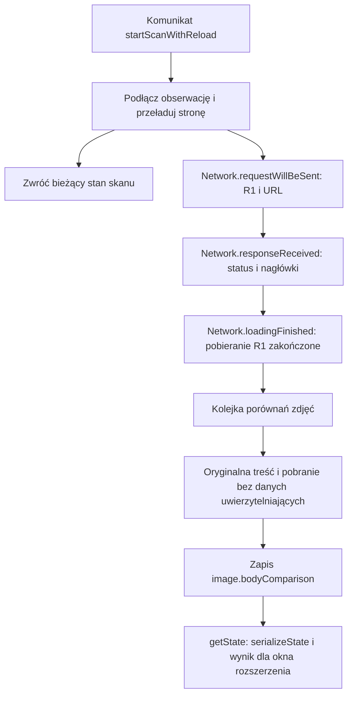

# Od uruchomienia skanu do wyniku zdjęcia

`startScanWithReload()` uruchamia obserwację strony i zleca jej przeładowanie. Zwrócenie wyniku tej funkcji **nie oznacza zakończenia analizy zdjęć**. Kolejne zdarzenia przeglądarki dopisują dane, a okno rozszerzenia pobiera bieżący wynik komunikatem `getState`.

Ten przewodnik śledzi jedno żądanie bez przekierowania: `requestId = "R1"`, URL `https://album.example/zdjecia/kot.jpg`. To wymyślony przykład do czytania kodu. Zdarzenia innych zdjęć, skryptów, ram i pól hasła mogą przeplatać się z jego obsługą.

[Mapa przepływów](README.md) · [Domeny i pola hasła](passwords-and-scripts.md) · [Ocena ryzyka](risk-assessment.md) · [Przepływ raportu](report.md)

## Gdzie zaczyna się wykonanie

[manifest.json](../../manifest.json) wskazuje [background.js](../../background.js) jako moduł działający w tle (service worker). Ten plik wywołuje `startBackgroundApplication()` z [composition/background.js](../../src/composition/background.js): tworzy magazyn stanu, łączy funkcje i rejestruje funkcje obsługi zdarzeń Chrome. Stan jest przechowywany w pamięci tego uruchomienia modułu tła.

„Port” to tutaj zwykła przekazana funkcja lub obiekt z metodami. Na przykład `browser.reloadPage(tabId)` w scenariuszu otrzymuje implementację z [scan-browser.js](../../src/technical/background/scan-browser.js). Ta implementacja wysyła komendę `Page.reload` przez `chrome.debugger`.

CDP, czyli Chrome DevTools Protocol, pozwala wysyłać polecenia do przeglądarki i odbierać jej zdarzenia. W tej ścieżce potrzebne są trzy identyfikatory:

| Wartość | Do czego służy w tym kodzie |
| --- | --- |
| `tabId` | Wybiera kartę oraz jej `ScanState` w mapie `tabStates`. |
| `requestId`, np. `R1` | Łączy zdarzenia jednego żądania i pozwala odczytać treść zarejestrowanej odpowiedzi. |
| `mainFrameId` | Wskazuje główną ramę strony przy osobnym pobraniu zasobu. Uzupełnia go `handleFrameNavigated()` w [page-observations.js](../../src/business/scanning/page-observations.js). |

Pełny URL jest osobnym kluczem: według niego skaner grupuje rekordy zdjęć. Kilka żądań tego samego URL może uzupełniać jeden rekord.

Treść odpowiedzi (pole `body` w protokole) oznacza tu bajty np. pliku JPG. SHA-256 jest obliczanym z tych bajtów skrótem; skaner porównuje skróty i długości, aby ustalić zgodność obu treści.

## Kolejność dla zdjęcia R1

Diagram pokazuje zwykłą ścieżkę jednego zakończonego pobrania. `getState` może zostać wywołane także wcześniej, gdy zdjęcie dopiero czeka lub jest porównywane.



| Etap | Funkcja i plik | Co dzieje się z R1 |
| --- | --- | --- |
| Polecenie z okna rozszerzenia | `handlePopupRequest()` w [extension-events.js](../../src/technical/background/extension-events.js) | `startScanWithReload` trafia do scenariusza startu. |
| Przygotowanie | `startScanWithReload()` w [scan-flow.js](../../src/business/scanning/scan-flow.js) | Resetuje wyniki karty, podłącza debugger, włącza zbieranie zdarzeń i monitor pól hasła, wyłącza pamięć podręczną, zleca przeładowanie strony. Nie czeka na porównania zdjęć. |
| Początek żądania | `handleRequestWillBeSent()` w [network-events.js](../../src/technical/background/network-events.js) | Zapamiętuje pod `R1` URL i typ zasobu. `addOrUpdateImage()` tworzy rekord, jeśli metadane pozwalają rozpoznać obraz. |
| Odpowiedź | `handleResponseReceived()` w [network-events.js](../../src/technical/background/network-events.js) | Uzupełnia metadane R1 o status HTTP, MIME i nagłówki, a następnie uzupełnia lub tworzy rekord zdjęcia. To jeszcze nie sygnał zakończenia pobierania treści odpowiedzi. |
| Koniec pobierania | `handleLoadingFinished()` w [network-events.js](../../src/technical/background/network-events.js) | Dodaje długość, zleca porównanie z URL odtworzonym ze scalonych metadanych, usuwa R1 z tymczasowych map żądań. |
| Kolejka | `enqueueImageBodyComparison()` i `runImageBodyCompareQueue()` w [image-comparison-flow.js](../../src/business/scanning/image-comparison-flow.js) | Sprawdzają warunki dopuszczenia, dodają `{ requestId: "R1", url }` i uruchamiają pracę, gdy jest miejsce. Limit to obecnie 2 aktywne porównania na kartę, zgodnie z [config.js](../../src/business/scanning/config.js). |
| Treści dwóch odpowiedzi | `compareImageBodyWithoutCredentials()` w [image-comparison-flow.js](../../src/business/scanning/image-comparison-flow.js) | Czyta treść odpowiedzi R1, oblicza SHA-256, pobiera ten sam URL bez danych uwierzytelniających i z pominięciem pamięci podręcznej, czyta treść drugiej odpowiedzi oraz oblicza jego SHA-256. Implementacje pobrań są w [resource-reader.js](../../src/technical/background/resource-reader.js). |
| Ocena i zapis | `assessImageBodyComparison()` w [image-comparison-rules.js](../../src/business/scanning/image-comparison-rules.js), następnie `setImageBodyComparison()` w [image-comparison-flow.js](../../src/business/scanning/image-comparison-flow.js) | Zgodność długości i SHA-256 daje `exactMatch`. Dopiero zgodność i dwa statusy HTTP 2xx dają `improperAuthorization`. Wynik trafia do istniejącego obiektu zdjęcia. |
| Odczyt wyniku | `getActiveTabState()` w [scan-flow.js](../../src/business/scanning/scan-flow.js) i `serializeState()` w [state-snapshot.js](../../src/business/scanning/state-snapshot.js) | `getState` odczytuje aktywną kartę i przygotowuje dane dla okna rozszerzenia. Przy podłączonym skanie może też odświeżyć metadane pól hasła i zlecić kontrole robots.txt. Nie czeka na ukończenie kolejki zdjęć. |

`handleDebuggerEvent()` w [extension-events.js](../../src/technical/background/extension-events.js) jest miejscem przekazującym nazwy zdarzeń CDP do powyższych funkcji obsługi. Obsługuje zdarzenie tylko wtedy, gdy znajdzie stan karty z `attached === true`.

## Kto zmienia dane

Magazyn [scan-state.js](../../src/business/scanning/scan-state.js) tworzy jeden mutowalny obiekt `ScanState` dla karty. Przekazane funkcje pracują na tym samym obiekcie; nie zwracają po każdym zdarzeniu nowego stanu aplikacji.

| Dane | Kto je zapisuje | Znaczenie |
| --- | --- | --- |
| `tabStates` | `ensureState()` w [scan-state.js](../../src/business/scanning/scan-state.js) | Mapa `tabId → ScanState`. |
| `attached`, `scanning`, `stopRequested`, `status`, czasy | Etapy startu/stopu w [scan-flow.js](../../src/business/scanning/scan-flow.js), funkcje obsługi w [scan-lifecycle.js](../../src/business/scanning/scan-lifecycle.js) | Sterowanie obserwacją i opis jej etapu; to nie wynik pojedynczego porównania. |
| `pageUrl`, `mainFrameId`, konteksty | Funkcje w [page-observations.js](../../src/business/scanning/page-observations.js) | Adres i informacje o stronie/ramach uzyskiwane z przeglądarki. |
| `imageRequests` | `mergeImageRequestMetadata()` w [image-records.js](../../src/business/scanning/image-records.js); usuwanie w funkcjach obsługi zakończenia lub błędu pobierania w [network-events.js](../../src/technical/background/network-events.js) | Tymczasowa mapa `requestId → częściowe metadane`. Są w niej również żądania, które nie zostaną uznane za zdjęcia. |
| `images`, `imagesByUrl` | `addOrUpdateImage()` w [image-records.js](../../src/business/scanning/image-records.js) | Tablica zachowuje kolejność dodania, mapa wyszukuje po pełnym URL. **Obie zawierają referencje do tych samych rekordów.** |
| `imageBodyCompareQueue`, `imageBodyCompareQueuedUrls`, `imageBodyCompareActiveCount` | Funkcje kolejki w [image-comparison-flow.js](../../src/business/scanning/image-comparison-flow.js); reset i funkcje obsługi cyklu życia | Oczekujące zadania, URL-e oczekujących zadań oraz licznik służący do limitowania rozpoczętej pracy. URL znika ze zbioru, gdy zadanie zaczyna się wykonywać. |
| `image.bodyComparison`, `image.previewDataUrl` | Funkcje w [image-comparison-flow.js](../../src/business/scanning/image-comparison-flow.js) | Porównanie aktualizuje istniejący rekord zdjęcia. Podgląd powstaje z oryginalnej treści odpowiedzi przy dodatnim `improperAuthorization`, jeśli adapter potrafi go utworzyć. |
| Pola wyniku, np. `improperImageAuthorization`, `cache`, `indexing` | `serializeImage()` w [state-snapshot.js](../../src/business/scanning/state-snapshot.js) | Pola wyliczane podczas przygotowywania wiadomości. `serializeState()` nie wysyła wewnętrznych map ani kolejki. |

Jeżeli R1 utworzył pierwsze zdjęcie, `state.images[0] === state.imagesByUrl.get("https://album.example/zdjecia/kot.jpg")`. Zmiana `image.bodyComparison` przez mapę jest więc widoczna przy późniejszym odczycie tablicy. Reset wymienia obie kolekcje na nowe.

Przygotowanie bieżącego wyniku tworzy nowy obiekt i tablicę zdjęć z polami audytu. Nie jest jednak głęboką kopią całego `ScanState`: `serializeImage()` używa płytkiego kopiowania operatorem `...`. Nie należy też traktować nazwy `ScanSnapshot` jako zapewnienia, że wszystkie zadania już się skończyły.

Przykład poniżej jest **schematycznym skrótem odpowiedzi na `getState`**, po udanym porównaniu jednej pary identycznych odpowiedzi HTTP 200. Pominięto m.in. pozostałe pola zdjęcia, hasła, skrypty, czasy i skróty SHA-256; to nie pełny kontrakt ani kompletny zestaw danych testowych.

```json
{
  "ok": true,
  "state": {
    "tabId": 7,
    "attached": true,
    "scanning": true,
    "status": "scanning",
    "imageCount": 1,
    "images": [
      {
        "url": "https://album.example/zdjecia/kot.jpg",
        "requestId": "R1",
        "status": 200,
        "bodyComparison": {
          "status": "same",
          "exactMatch": true,
          "improperAuthorization": true,
          "noCredentialsStatus": 200
        },
        "bodyExactMatchNoCredentials": true,
        "improperImageAuthorization": true
      }
    ]
  }
}
```

Pełne opisy pól są w [types/scanning.js](../../types/scanning.js). Kształty zdarzeń przeglądarki opisuje [types/cdp.js](../../types/cdp.js). Są to komentarze JSDoc dla edytora i sprawdzania typów, nie kod wykonywany przez Chrome.

## Trzy różne znaczenia słowa „status”

`state.status` opisuje obserwację całej karty. `image.status` jest liczbą HTTP albo `null`. `image.bodyComparison.status` opisuje pracę nad porównaniem treści dwóch odpowiedzi.

Wartości `state.status` wpisywane przez obecny kod:

| Wartość | Kiedy jest zapisywana |
| --- | --- |
| `idle` | Utworzenie stanu albo pusty wynik dla karty bez stanu. |
| `attaching` | `beginNewScan()`, także gdy połączenie z debuggerem już istnieje. |
| `scanning` | `attachObservation()` przed pełnym przygotowaniem i ponownie `markScanReady()` po zleceniu przeładowania strony. Nie oznacza gotowych wyników. |
| `stopping` | `stopScan()` przed oczekiwaniem na odłączenie. |
| `stopped` | Stop bez podłączonego debuggera, udany stop lub funkcja obsługi odłączenia przy `stopRequested === true`. |
| `error` | Obsługa nieudanego startu albo nieudanego odłączenia w `stopScan()`. |
| `detached` | Funkcja obsługi odłączenia, gdy nie jest to odłączenie oznaczone przez `stopRequested` ani powód `target_closed`. |
| `closed` | Funkcja obsługi usunięcia karty albo odłączenie z powodem `target_closed`, o ile wcześniejsza gałąź `stopRequested` nie zakończyła funkcji obsługi. |

Te pola nie tworzą osobnej maszyny stanów wymuszającej wszystkie kombinacje. `attached` zapisuje stan podłączenia i jest używane do dopuszczania pracy. `scanning` opisuje aktywność raportowaną przez aplikację. Przy `stopping` obie flagi mogą nadal być `true`. Przy błędzie odłączenia `stopScan()` nie zeruje ich w swojej gałęzi `catch`; mogą zostać zmienione przez zdarzenie Chrome. `stopRequested` służy do rozpoznania odłączenia zleconego przez aplikację, także podczas sprzątania po nieudanym starcie.

Status wynika z ostatniego zapisu. Na przykład `recoverFailedStart()` wpisuje `error`, a późniejsze zdarzenie odłączenia może wpisać inny status zgodnie z `handleDebuggerDetached()`. Źródła: [scan-flow.js](../../src/business/scanning/scan-flow.js), [scan-state.js](../../src/business/scanning/scan-state.js), [scan-lifecycle.js](../../src/business/scanning/scan-lifecycle.js).

Wartości `image.bodyComparison.status` z [image-comparison-flow.js](../../src/business/scanning/image-comparison-flow.js):

| Wartość | Co znaczy |
| --- | --- |
| Brak `bodyComparison` | Rekord nie ma jeszcze opisanego wyniku porównania. To brak pola, nie osobny status. |
| `queued` | Zadanie dopuszczono do kolejki. Może natychmiast przejść do `checking`. |
| `checking` | Rozpoczęto porównywanie treści odpowiedzi. |
| `same` | Długości i SHA-256 są zgodne. `improperAuthorization` dodatkowo wymaga obu statusów HTTP 2xx. |
| `different` | Długości lub SHA-256 są różne. |
| `skipped` | Kontrola długości przed kolejką lub po odczycie gotowej treści odpowiedzi wykryła przekroczenie limitu. |
| `error` | Np. brak głównej ramy, błąd polecenia CDP, nieudane pobranie bez danych uwierzytelniających albo wyjątek podczas odczytu. Przekroczenie limitu w trakcie czytania strumienia również rzuca wyjątek i trafia tutaj. |

Limit porównywanej treści odpowiedzi wynosi obecnie `25 * 1024 * 1024` bajtów. Nie każdy zasób otrzymuje status `skipped`: brak URL, nieobsługiwany protokół, brak rekordu zdjęcia lub brak podłączenia mogą zakończyć `enqueueImageBodyComparison()` bez zapisu wyniku. Funkcja `isRobotsCheckableUrl()` jest tu współdzielonym sprawdzeniem URL HTTP/HTTPS; jej nazwa nie oznacza, że wynik robots.txt decyduje o porównaniu treści odpowiedzi.

## Stop, ponowny start i odłączenie

| Sytuacja | Zachowanie obecnego kodu |
| --- | --- |
| `stopScan()` | Zatrzymuje cykliczne sprawdzanie pól hasła i zleca odłączenie. Zachowuje dotychczasowe rekordy. Wybiera podłączony stan aktywnej karty, a jeśli takiego nie ma, szuka podłączonego stanu innej karty. |
| `handleDebuggerDetached()` | Ustawia `attached` i `scanning` na `false`, usuwa oczekującą kolejkę i zbiór jej URL-i, zeruje licznik aktywnych porównań, zapisuje czasy i odpowiedni status. Zachowuje zdjęcia i pozostałe wyniki. |
| `handleTabRemoved()` | Czyści oczekującą pracę podobnie do odłączenia i wpisuje `closed`. Zachowuje rekord stanu w `tabStates`. |
| `resetScanData()` przy ponownym starcie | Zatrzymuje cykliczne sprawdzanie, wymienia kolekcje zdjęć, żądań, skryptów, porównań i innych obserwacji oraz zeruje ich pomocnicze dane. Zachowuje obiekt `ScanState`; samo nie odłącza debuggera. Następne etapy startu ustawiają adres, czasy, status i aktywność. |

**Żadna z tych operacji nie czeka na zakończenie wszystkich rozpoczętych porównań ani nie anuluje ich Promise.** Usunięcie oczekującej kolejki nie oznacza wykonania jej zadań. Już rozpoczęta operacja może jeszcze zakończyć się wynikiem lub błędem. Po resecie może nadal posiadać referencję do starego rekordu; obsługa błędu kolejki szuka rekordu po URL w bieżącej mapie. Nie należy zakładać, że reset jest granicą anulowania wszystkich zapisów asynchronicznych.

Kod nie ma statusu porównania `cancelled` ani statusu skanu `completed`. Przy usunięciu kolejki istniejące `bodyComparison.status` nie jest automatycznie zmieniane, więc zachowany rekord może nadal pokazywać `queued` lub `checking`. Szczegóły są w `runImageBodyCompareQueue()` w [image-comparison-flow.js](../../src/business/scanning/image-comparison-flow.js), `stopScan()` w [scan-flow.js](../../src/business/scanning/scan-flow.js) i funkcjach obsługi [scan-lifecycle.js](../../src/business/scanning/scan-lifecycle.js).

## Gdzie patrzeć, gdy brak zdjęcia

Sprawdzaj najpierw, na którym etapie znika rekord; brak kafelka w oknie rozszerzenia nie oznacza automatycznie braku obserwacji w skanerze.

| Co sprawdzić | Miejsce w kodzie |
| --- | --- |
| Czy odczytujesz skan właściwej aktywnej karty? Czy stan ma `attached === true` i czy debugger wysyła zdarzenia? | `getActiveTabState()` w [scan-flow.js](../../src/business/scanning/scan-flow.js), `handleDebuggerEvent()` w [extension-events.js](../../src/technical/background/extension-events.js). |
| Czy request/response R1 zawierały URL i dane pozwalające rozpoznać obraz? Obraz jest rozpoznawany po typie `Image`, MIME `image/…` lub typowym URL. | `handleRequestWillBeSent()` i `handleResponseReceived()` w [network-events.js](../../src/technical/background/network-events.js); `isImageLike()` i `addOrUpdateImage()` w [image-records.js](../../src/business/scanning/image-records.js). |
| Czy nadeszło `loadingFinished`, czy zamiast niego `loadingFailed`? Ścieżka błędu nie kolejkuje porównania zdjęcia. | Funkcje obsługi zdarzeń w [network-events.js](../../src/technical/background/network-events.js). |
| Czy URL jest HTTP/HTTPS, istnieje rekord, limit rozmiaru pozwala na porównanie i jest główna rama? Co zawierają `bodyComparison.status`, `reason` i `error`? | `enqueueImageBodyComparison()` i `compareImageBodyWithoutCredentials()` w [image-comparison-flow.js](../../src/business/scanning/image-comparison-flow.js), [resource-reader.js](../../src/technical/background/resource-reader.js). |
| Czy porównanie dało `same`, ale `improperAuthorization` jest `false` z powodu statusów HTTP? | `assessImageBodyComparison()` w [image-comparison-rules.js](../../src/business/scanning/image-comparison-rules.js). |
| Czy rekord jest już w `getState`, ale filtr okna rozszerzenia go nie pokazuje? Okno rozszerzenia wymaga wyniku nieprawidłowej autoryzacji, formatu JPEG/JPG lub PNG i pomiaru z dłuższym bokiem co najmniej 200 px. Warunki są jednakowe dla obu formatów. Pomiar może jeszcze trwać. | `getFilteredImageRows()` w [image-rules.js](../../src/business/popup/image-rules.js) i opis okna rozszerzenia w [przewodniku głównym](README.md). |
